=====================================
**Proseslerin Sanal Bellek Alanları**
=====================================

Bu bölümde proseslerin sanal bellek alanlarının nasıl oluşturulduğu ve nasıl yönetildiği üzerinde duracağız.
Anımsanacağı gibi UNIX/Linux sistemlerinde yeni bir proses ``fork`` isimli POSIX fonksiyonuyla yeni bir thread de
``pthread_create`` isimli POSIX fonksiyonuyla yaratılmaktadır. Bu fonksiyonlar nihayetinde Linux çekirdeğindeki
``sys_fork`` ve/veya ``sys_clone`` fonksiyonlarını çağırmaktadır. ``fork`` fonksiyonunun bir prosesin özdeş kopyasını
oluşturduğunu anımsayınız. ``fork`` fonksiyonu çağrıldığında yeni bir ``task_struct`` (proses kontrol bloğu) nesnesi
yaratılmakta ve kabaca üst prosesin ``task_struct`` nesnesinin içeriği alt prosesin ``task_struct`` nesnesine
kopyalanmaktadır. ``task_struct`` içerisindeki elemanların birçoğunun göstericiler yoluyla asıl nesneleri gösterdiğini
anımsayınız. Dolayısıyla ``fork`` işlemi büyük ölçüde *derin (deep)* kopyalama biçiminde değil *sığ (shallow)* kopyalama
biçiminde yürütülmektedir. Biz proseslerin ve thread'lerin yaratılması sürecini sonraki bölümde ele alacağız. ``exec``
fonksiyonlarının bir prosesin yaşamına başka bir kodla devam etmesini sağladığını anımsayınız. ``exec`` işlemi
uygulandığında prosesin bellek alanı boşaltılıp başka bir program dosyasından hareketle yeni bir bellek alanı
oluşturulmakta ve proses yaşamına başka bir programın koduyla devam etmektedir. Anımsanacağı gibi UNIX/Linux
sistemlerinde "hem mevcut program çalışmaya devam etsin hem de başka bir program da çalışsın" isteniyorsa yalnızca
``fork`` ve yalnızca ``exec`` yetersiz kalmaktadır. Bu işlem tipik olarak önce ``fork`` uygulanıp alt proseste ``exec``
uygulanarak gerçekleştirilmektedir. Örneğin:

.. code-block:: c

    pid_t pid;
    /* ... */

    if ((pid = fork()) == -1)
        exit_sys("fork");

    if (pid == 0 && execl("/bin/ls", "/bin/ls", "-l", (char *)NULL) == -1)
        exit_sys("execl");

    /* ... */

Yeni prosesin ``fork`` içerisinden çalışmaya başladığını, ``fork`` fonksiyonundan alt prosesin ``0`` ile, üst prosesin
alt prosesin çıkış koduyla çıktığını anımsayınız.

Biz bu süreci zaten ayrı bir bölümde ele alacağız. Bu bölümde biz prosesin bellek alanının nasıl kayıt altında
tutulduğunu ele alacağız.

Bellek Betimleyicileri ve Sanal Bellek Alanları
===============================================

Prosesin bellek alanına ilişkin tüm bilgiler ``task_struct`` yapısındaki ``mm`` ve/veya ``active_mm`` elemanlarının
gösterdiği ``mm_struct`` nesnelerinde tutulmaktadır:

.. code-block:: c

    struct task_struct {
        /* ... */
        struct mm_struct *mm;
        struct mm_struct *active_mm;
        /* ... */
    };

``mm_struct`` yapısı üzerinde çekirdeğin çeşitli versiyonlarında iyileştirmeler yapılmıştır. Güncel
çekirdeklerde bu yapı oldukça büyüktür:

.. code-block:: c

    struct mm_struct {
        struct {
            /*
             * Fields which are often written to are placed in a separate
             * cache line.
             */
            struct {
                /**
                 * @mm_count: The number of references to &struct
                 * mm_struct (@mm_users count as 1).
                 *
                 * Use mmgrab()/mmdrop() to modify. When this drops to
                 * 0, the &struct mm_struct is freed.
                 */
                atomic_t mm_count;
            } ____cacheline_aligned_in_smp;

            struct maple_tree mm_mt;

            unsigned long mmap_base; /* base of mmap area */
            unsigned long mmap_legacy_base; /* base of mmap area in bottom-up allocations */
    #ifdef CONFIG_HAVE_ARCH_COMPAT_MMAP_BASES
            /* Base addresses for compatible mmap() */
            unsigned long mmap_compat_base;
            unsigned long mmap_compat_legacy_base;
    #endif
            unsigned long task_size; /* size of task vm space */
            pgd_t *pgd;

    #ifdef CONFIG_MEMBARRIER
            /**
             * @membarrier_state: Flags controlling membarrier behavior.
             *
             * This field is close to @pgd to hopefully fit in the same
             * cache-line, which needs to be touched by switch_mm().
             */
            atomic_t membarrier_state;
    #endif

            /**
             * @mm_users: The number of users including userspace.
             *
             * Use mmget()/mmget_not_zero()/mmput() to modify. When this
             * drops to 0 (i.e. when the task exits and there are no other
             * temporary reference holders), we also release a reference on
             * @mm_count (which may then free the &struct mm_struct if
             * @mm_count also drops to 0).
             */
            atomic_t mm_users;

            /* MM CID related storage */
            struct mm_mm_cid mm_cid;

            /* sched_cache related statistics */
            struct sched_cache_stat sc_stat;
    #ifdef CONFIG_MMU
            atomic_long_t pgtables_bytes; /* size of all page tables */
    #endif
            int map_count; /* number of VMAs */

            spinlock_t page_table_lock; /* Protects page tables and some
                                         * counters
                                         */
            /*
             * Typically the current mmap_lock's offset is 56 bytes from
             * the last cacheline boundary, which is very optimal, as
             * its two hot fields 'count' and 'owner' sit in 2 different
             * cachelines, and when mmap_lock is highly contended, both
             * of the 2 fields will be accessed frequently, current layout
             * will help to reduce cache bouncing.
             *
             * So please be careful with adding new fields before
             * mmap_lock, which can easily push the 2 fields into one
             * cacheline.
             */
            struct rw_semaphore mmap_lock;

            struct list_head mmlist; /* List of maybe swapped mm's. These
                                      * are globally strung together off
                                      * init_mm.mmlist, and are protected
                                      * by mmlist_lock
                                      */
    #ifdef CONFIG_PER_VMA_LOCK
            struct rcuwait vma_writer_wait;
            /*
             * This field has lock-like semantics, meaning it is sometimes
             * accessed with ACQUIRE/RELEASE semantics.
             * Roughly speaking, incrementing the sequence number is
             * equivalent to releasing locks on VMAs; reading the sequence
             * number can be part of taking a read lock on a VMA.
             * Incremented every time mmap_lock is write-locked/unlocked.
             * Initialized to 0, therefore odd values indicate mmap_lock
             * is write-locked and even values that it's released.
             *
             * Can be modified under write mmap_lock using RELEASE
             * semantics.
             * Can be read with no other protection when holding write
             * mmap_lock.
             * Can be read with ACQUIRE semantics if not holding write
             * mmap_lock.
             */
            seqcount_t mm_lock_seq;
    #endif
            struct futex_mm_data futex;

            unsigned long hiwater_rss; /* High-watermark of RSS usage */
            unsigned long hiwater_vm; /* High-water virtual memory usage */

            unsigned long total_vm; /* Total pages mapped */
            unsigned long locked_vm; /* Pages that have PG_mlocked set */
            atomic64_t pinned_vm; /* Refcount permanently increased */
            unsigned long data_vm; /* VM_WRITE & ~VM_SHARED & ~VM_STACK */
            unsigned long exec_vm; /* VM_EXEC & ~VM_WRITE & ~VM_STACK */
            unsigned long stack_vm; /* VM_STACK */
            union {
                /* Temporary while VMA flags are being converted. */
                vm_flags_t def_flags;
                vma_flags_t def_vma_flags;
            };

            /**
             * @write_protect_seq: Locked when any thread is write
             * protecting pages mapped by this mm to enforce a later COW,
             * for instance during page table copying for fork().
             */
            seqcount_t write_protect_seq;

            spinlock_t arg_lock; /* protect the below fields */

            unsigned long start_code, end_code, start_data, end_data;
            unsigned long start_brk, brk, start_stack;
            unsigned long arg_start, arg_end, env_start, env_end;

            unsigned long saved_auxv[AT_VECTOR_SIZE]; /* for /proc/PID/auxv */

    #ifdef CONFIG_ARCH_HAS_ELF_CORE_EFLAGS
            /* the ABI-related flags from the ELF header. Used for core dump */
            unsigned long saved_e_flags;
    #endif

            struct percpu_counter rss_stat[NR_MM_COUNTERS];

            struct linux_binfmt *binfmt;

            /* Architecture-specific MM context */
            mm_context_t context;

            mm_flags_t flags; /* Must use mm_flags_* helpers to access */

    #ifdef CONFIG_AIO
            spinlock_t ioctx_lock;
            struct kioctx_table __rcu *ioctx_table;
    #endif
    #ifdef CONFIG_MEMCG
            /*
             * "owner" points to a task that is regarded as the canonical
             * user/owner of this mm. All of the following must be true in
             * order for it to be changed:
             *
             * current == mm->owner
             * current->mm != mm
             * new_owner->mm == mm
             * new_owner->alloc_lock is held
             */
            struct task_struct __rcu *owner;
    #endif

            /* store ref to file /proc/<pid>/exe symlink points to */
            struct file __rcu *exe_file;
    #ifdef CONFIG_MMU_NOTIFIER
            struct mmu_notifier_subscriptions *notifier_subscriptions;
    #endif
    #if defined(CONFIG_TRANSPARENT_HUGEPAGE) && !defined(CONFIG_SPLIT_PMD_PTLOCKS)
            pgtable_t pmd_huge_pte; /* protected by page_table_lock */
    #endif
    #ifdef CONFIG_NUMA_BALANCING
            /*
             * numa_next_scan is the next time that PTEs will be remapped
             * PROT_NONE to trigger NUMA hinting faults; such faults gather
             * statistics and migrate pages to new nodes if necessary.
             */
            unsigned long numa_next_scan;

            /* Restart point for scanning and remapping PTEs. */
            unsigned long numa_scan_offset;

            /* numa_scan_seq prevents two threads remapping PTEs. */
            int numa_scan_seq;
    #endif
            /*
             * An operation with batched TLB flushing is going on. Anything
             * that can move process memory needs to flush the TLB when
             * moving a PROT_NONE mapped page.
             */
            atomic_t tlb_flush_pending;
    #ifdef CONFIG_ARCH_WANT_BATCHED_UNMAP_TLB_FLUSH
            /* See flush_tlb_batched_pending() */
            atomic_t tlb_flush_batched;
    #endif
            struct uprobes_state uprobes_state;
    #ifdef CONFIG_PREEMPT_RT
            struct rcu_head delayed_drop;
    #endif
    #ifdef CONFIG_HUGETLB_PAGE
            atomic_long_t hugetlb_usage;
    #endif
            struct work_struct async_put_work;

    #ifdef CONFIG_IOMMU_MM_DATA
            struct iommu_mm_data *iommu_mm;
    #endif
    #ifdef CONFIG_KSM
            /*
             * Represent how many pages of this process are involved in KSM
             * merging (not including ksm_zero_pages).
             */
            unsigned long ksm_merging_pages;
            /*
             * Represent how many pages are checked for ksm merging
             * including merged and not merged.
             */
            unsigned long ksm_rmap_items;
            /*
             * Represent how many empty pages are merged with kernel zero
             * pages when enabling KSM use_zero_pages.
             */
            atomic_long_t ksm_zero_pages;
    #endif /* CONFIG_KSM */
    #ifdef CONFIG_LRU_GEN_WALKS_MMU
            struct {
                /* this mm_struct is on lru_gen_mm_list */
                struct list_head list;
                /*
                 * Set when switching to this mm_struct, as a hint of
                 * whether it has been used since the last time per-node
                 * page table walkers cleared the corresponding bits.
                 */
                unsigned long bitmap;
    #ifdef CONFIG_MEMCG
                /* points to the memcg of "owner" above */
                struct mem_cgroup *memcg;
    #endif
            } lru_gen;
    #endif /* CONFIG_LRU_GEN_WALKS_MMU */
    #ifdef CONFIG_MM_ID
            mm_id_t mm_id;
    #endif /* CONFIG_MM_ID */
        } __randomize_layout;

        /*
         * The mm_cpumask needs to be at the end of mm_struct, because it
         * is dynamically sized based on nr_cpu_ids.
         */
        char flexible_array[] __aligned(__alignof__(unsigned long));
    };

``mm_struct`` yapısı prosesin sanal bellek alanına ilişkin tüm bilgileri tutmaktadır. Ancak yukarıda da gördüğünüz gibi
yapı oldukça karmaşıktır.

Prosesin sanal adres alanına ilişkin bilgileri tutan ``mm_struct`` nesnesine *Understanding the Linux Kernel* kitabında
*bellek betimleyicisi (memory descriptor)* da denilmektedir. *Bellek betimleyicisi* terimi çekirdek geliştirme
terminolojisinde kullanılan bir terim değildir. Ancak biz de kştabımızda bu nesneye *bellek betimleyicisi* de diyeceğiz.

Prosesin sanal adres alanı içerisindeki aynı özelliklere sahip sayfalardan oluşan alanlar ``vm_area_struct`` isimli bir
yapıyla temsil edilmektedir. Güncel çekirdeklerde bu yapı şöyle tanımlanmıştır:

.. code-block:: c

    struct vm_area_struct {
        /* The first cache line has the info for VMA tree walking. */

        union {
            struct {
                /* VMA covers [vm_start; vm_end) addresses within mm */
                unsigned long vm_start;
                unsigned long vm_end;
            };
            freeptr_t vm_freeptr; /* Pointer used by SLAB_TYPESAFE_BY_RCU */
        };

        /*
         * The address space we belong to.
         * Unstable RCU readers are allowed to read this.
         */
        struct mm_struct *vm_mm;
        pgprot_t vm_page_prot; /* Access permissions of this VMA. */

        /*
         * Flags, see mm.h.
         * To modify use vm_flags_{init|reset|set|clear|mod} functions.
         * Preferably, use vma_flags_xxx() functions.
         */
        union {
            /* Temporary while VMA flags are being converted. */
            const vm_flags_t vm_flags;
            vma_flags_t flags;
        };

    #ifdef CONFIG_PER_VMA_LOCK
        /*
         * Can only be written (using WRITE_ONCE()) while holding both:
         *  - mmap_lock (in write mode)
         *  - vm_refcnt bit at VM_REFCNT_EXCLUDE_READERS_FLAG is set
         * Can be read reliably while holding one of:
         *  - mmap_lock (in read or write mode)
         *  - vm_refcnt bit at VM_REFCNT_EXCLUDE_READERS_BIT is set or vm_refcnt > 1
         * Can be read unreliably (using READ_ONCE()) for pessimistic bailout
         * while holding nothing (except RCU to keep the VMA struct allocated).
         *
         * This sequence counter is explicitly allowed to overflow; sequence
         * counter reuse can only lead to occasional unnecessary use of the
         * slowpath.
         */
        unsigned int vm_lock_seq;
    #endif
        /*
         * A file's MAP_PRIVATE vma can be in both i_mmap tree and anon_vma
         * list, after a COW of one of the file pages. A MAP_SHARED vma
         * can only be in the i_mmap tree.  An anonymous MAP_PRIVATE, stack
         * or brk vma (with NULL file) can only be in an anon_vma list.
         */
        struct list_head anon_vma_chain; /* Serialized by mmap_lock &
                                          * page_table_lock */
        struct anon_vma *anon_vma; /* Serialized by page_table_lock */

        /* Function pointers to deal with this struct. */
        const struct vm_operations_struct *vm_ops;

        /* Information about our backing store: */
        unsigned long vm_pgoff; /* Offset (within vm_file) in PAGE_SIZE
                                    units */
        struct file *vm_file; /* File we map to (can be NULL). */
        void *vm_private_data; /* was vm_pte (shared mem) */

    #ifdef CONFIG_SWAP
        atomic_long_t swap_readahead_info;
    #endif
    #ifndef CONFIG_MMU
        struct vm_region *vm_region; /* NOMMU mapping region */
    #endif
    #ifdef CONFIG_NUMA
        struct mempolicy *vm_policy; /* NUMA policy for the VMA */
    #endif
    #ifdef CONFIG_NUMA_BALANCING
        struct vma_numab_state *numab_state; /* NUMA Balancing state */
    #endif
    #ifdef CONFIG_PER_VMA_LOCK
        /*
         * Used to keep track of firstly, whether the VMA is attached, secondly,
         * if attached, how many read locks are taken, and thirdly, if the
         * VM_REFCNT_EXCLUDE_READERS_FLAG is set, whether any read locks held
         * are currently in the process of being excluded.
         *
         * This value can be equal to:
         *
         * 0 - Detached. IMPORTANT: when the refcnt is zero, readers cannot
         * increment it.
         *
         * 1 - Attached and either unlocked or write-locked. Write locks are
         * identified via __is_vma_write_locked() which checks for equality of
         * vma->vm_lock_seq and mm->mm_lock_seq.
         *
         * >1, < VM_REFCNT_EXCLUDE_READERS_FLAG - Read-locked or (unlikely)
         * write-locked with other threads having temporarily incremented the
         * reference count prior to determining it is write-locked and
         * decrementing it again.
         *
         * VM_REFCNT_EXCLUDE_READERS_FLAG - Detached, pending
         * __vma_end_exclude_readers() completion which will decrement the
         * reference count to zero. IMPORTANT - at this stage no further readers
         * can increment the reference count. It can only be reduced.
         *
         * VM_REFCNT_EXCLUDE_READERS_FLAG + 1 - A thread is either write-locking
         * an attached VMA and has yet to invoke __vma_end_exclude_readers(),
         * OR a thread is detaching a VMA and is waiting on a single spurious
         * reader in order to decrement the reference count. IMPORTANT - as
         * above, no further readers can increment the reference count.
         *
         * > VM_REFCNT_EXCLUDE_READERS_FLAG + 1 - A thread is either
         * write-locking or detaching a VMA is waiting on readers to
         * exit. IMPORTANT - as above, no further readers can increment the
         * reference count.
         *
         * NOTE: Unstable RCU readers are allowed to read this.
         */
        refcount_t vm_refcnt ____cacheline_aligned_in_smp;
    #ifdef CONFIG_DEBUG_LOCK_ALLOC
        struct lockdep_map vmlock_dep_map;
    #endif
    #endif
        /*
         * For areas with an address space and backing store,
         * linkage into the address_space->i_mmap interval tree.
         *
         */
        struct {
            struct rb_node rb;
            unsigned long rb_subtree_last;
        } shared;
    #ifdef CONFIG_ANON_VMA_NAME
        /*
         * For private and shared anonymous mappings, a pointer to a null
         * terminated string containing the name given to the vma, or NULL if
         * unnamed. Serialized by mmap_lock. Use anon_vma_name to access.
         */
        struct anon_vma_name *anon_name;
    #endif
        struct vm_userfaultfd_ctx vm_userfaultfd_ctx;
    #ifdef __HAVE_PFNMAP_TRACKING
        struct pfnmap_track_ctx *pfnmap_track_ctx;
    #endif
    } __randomize_layout;

Karmaşık bu iki veri yapısını basite indirgersek bunları söyleyebiliriz: Prosesin tüm sanal bellek alanına ilişkin
bilgiler ``task_struct`` nesnesinin ``mm`` ve/veya ``active_mm`` elemanlarının gösterdiği ``mm_struct`` nesnesi
içerisindedir. ``mm_struct`` nesnesi de sanal bellek alanlarını belirten ``vm_area_struct`` nesnelerini tutmaktadır.
Çekirdek terminolojisinde hem ``vm_area_struct`` nesnesine hem de onun belirttiği bellek aralığına *VMA (Virtual Memory
Area)* denilmektedir. Biz kursumuzda iki anlamlılığı ortadan kaldırmak için ``vm_area_struct`` nesnesine *sanal bellek
alanı nesnesi* ya da kısaca *VMA nesnesi*, onun belirttiği bellek aralığına ise *sanal bellek alanı* ya da kısaca *VMA*
diyeceğiz. (``mm_struct`` ile belirtilen sanal bellek alanları için *Understanding the Linux Kernel* kitabında *memory area* 
terimi yerine *memory region* terimi kullanılmıştır. *Memory region* terimi çekirdek geliştirme terminolojisinde kullanılan 
bir terim değildir.)

*VMA*'lar tamamen prosesin sanal bellek alanı ile ilgilidir. *VMA*'lar içerisinde fiziksel belleğe ilişkin hiçbir bilgi
tutulmamaktadır. Fiziksel bellek eşleştirmeleri doğrudan sayfa tablosu yoluyla yapılmaktadır.

``mm_struct`` yapısı içerisinde alanlar eskiden *kırmızı-siyah ağacı (red-black tree)* ile tutuluyordu. Çekirdeğin 6.1
versiyonuyla birlikte *maple ağacı (maple tree)* denilen bütünleşik bir veri yapısı kullanılmaya başlanmıştır. Bu
ağacın kök düğümü ``mm_struct`` içerisindeki ``mm_mt`` elemanında tutulmaktadır:

.. code-block:: c

    struct mm_struct {
        /* ... */
        struct {
            struct maple_tree mm_mt;        /* tek yapı: tüm VMA'lar */
            /* ... */
        };
        /* ... */
    };

Peki neden iki ayrı gösterici bulundurulmuştur? Çekirdek thread'lerine bağlamsal geçiş daha az maliyetli olsun diye
``mm`` elemanının yeniden düzenlenmesi yerine ``active_mm`` elemanı kullanılmaktadır. Proses thread'lerinde bu iki
eleman aslında aynı bellek betimleyicisini göstermektedir.

.. figure:: _static/mm-active-mm-table.png
   :align: center
   :width: 60%

Yani ``mm`` göstericisi "bu thread'in sahip olduğu adres alanını", ``active_mm`` göstericisi ise "o anda işlemcinin sayfa
tablosunda yüklü olan thread'in adres alanını" belirtmektedir. Yukarıda da belirttiğimiz gibi normal proses
thread'lerinde bu iki gösterici aslında aynı bellek betimleyicisini göstermektedir. Farklılaşma çekirdek thread'lerinde
söz konusu olmaktadır. Örneğin *kswapd* gibi *ksoftirqd* gibi *kworker* gibi çekirdek thread'lerinin kullanıcı alanı
yoktur. Bunların ``mm`` göstericileri ``NULL`` durumdadır. Bunların bellek alanları ``active_mm`` göstericisi tarafından
gösterilmektedir. ``active_mm`` elemanı hiçbir zaman ``NULL`` olmamaktadır. Bu eleman kullanıcı proseslerine ilişkin
thread'lerde zaten ``mm`` elemanı ile aynı nesneyi göstermektedir. Çekirdek thread'lerinde ise geçişin yapıldığı (yani
önceki) thread'e ilişkin ``mm_struct`` nesnesini göstermektedir.

Bir proses thread'inden çekirdek thread'ine geçiş yapıldığında sayfa tablosu çekirdek thread'i için değiştirilmez.
Çünkü zaten çekirdek alanı tüm proses thread'lerinin sayfa tablolarında aynı yerde ve aynı biçimde bulunmaktadır. Yani
geçilen çekirdek thread'i aslında geçişin yapıldığı önceki proses thread'inin sayfa tablosunu ödünç almaktadır. Buna
Linux çekirdek terminolojisinde *Lazy TLB* denilmektedir. İşte ``active_mm`` elemanı böylesi bir durumda ödünç alınan
proses thread'inin bellek alanı bilgilerini göstermektedir. Örneğin *bash* prosesine ilişkin bir thread'ten *kswapd*
thread'ine geçiliyor olsun. Oradan da *firefox* prosesinin thread'ine geçilsin. Bu senaryodaki ``mm`` ve ``active_mm``
elemanları aşağıdaki gibi değişecektir:

.. figure:: _static/active-mm-lazy-tlb-timeline.png
   :align: center
   :width: 95%

Çekirdek thread'leri zaten kullanıcı alanına hiç erişmemektedir, bu nedenle işlemcinin de hangi sayfa tablosunu
gösterdiğinin bir önemi yoktur.

Peki neden ``mm`` ve ``active_mm`` biçiminde iki gösterici vardır? Yalnızca ``mm`` ya da ``active_mm`` olsaydı ne
olurdu? İşte çekirdek içerisinde bazı yerlerde "şu anda çalışan çekirdek thread'i mi, adres alanı aslında geçişin
yapıldığı thread'ten ödünç alınmış bir adres alanı mı" kontrolü yapılmaktadır. Çekirdek bu kontrolü pek çok yerde
``mm == NULL`` ile yapmaktadır. Çekirdek ``mm == NULL`` gördüğü zaman bellek betimleyicisi ödünç alınmış bir çekirdek
thread'inin söz konusu olduğunu anlamakta ve bellek alanına artık ``active_mm`` göstericisiyle erişmektedir. Örneğin
aygıt sürücülerde kullandığımız ``copy_from_user`` fonksiyonunu biz çekirdek thread'lerinde kullanamayız. Çünkü çekirdek
thread'leri belli bir proses bağlamında çalışmamaktadır. İşte bu ``copy_from_user`` gibi bir fonksiyonu biz çekirdek
thread'i içerisinde kullandığımızda bu fonksiyon kendi içerisinde ``if (current->mm == NULL)`` kontrolü yaptığı için
hemen başarısızlıkla geri dönmektedir. Özetle çekirdek kodlarında ``if (current->mm == NULL)`` kontrolü "bu bir çekirdek
thread'i mi" sorusunu yanıtlamaktadır.

Sistemdeki tüm proseslerin sayfa tablolarının yüksek anlamlı kısımlarının aslında hep aynı olduğunu ve bu alanların
çekirdeğe ilişkin olduğunu anımsayınız. Kullanıcı prosesine ilişkin bir thread'ten çekirdek thread'ine geçildiğinde
sayfa tablosunun değiştirilmesine gerek kalmamaktadır. Çekirdek thread'i geçilen proses thread'inin sayfa tablosunu
kullanmaya devam etmektedir.

Çekirdek kodlarında prosesin sanal bellek alanına erişmek için her zaman ``mm`` göstericisi kullanılmaktadır.
``active_mm`` göstericisi çekirdekte yalnızca bazı yerlerde kullanılmaktadır.

Linux'ta thread'lerin de sanki prosesler gibi ``task_struct`` nesnesine sahip olduğunu ancak prosesin thread'lerinin
aynı bellek alanını kullandığını anımsayınız. İşte prosesin tüm thread'leri aslında aynı bellek betimleyicisini (yani
``mm_struct`` nesnesini) göstermektedir. Bunu bir şekille şöyle gösterebiliriz:

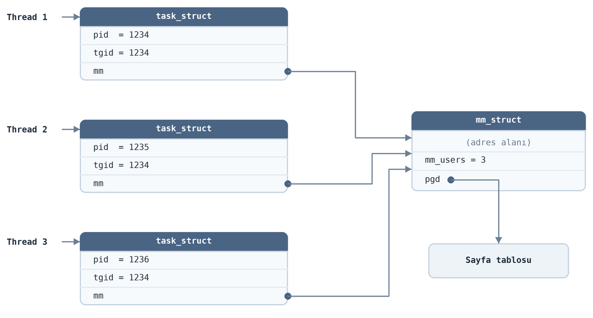

Burada aynı prosesin üç thread'i temsili olarak gösterilmiştir. Anımsanacağı gibi bunların hepsinin farklı ``pid``
değerleri vardır. ``tgid`` değeri prosesin ana thread'ine ilişkin ``pid`` değerini tutmaktadır. Zaten bu değer prosesin
``pid`` değeri olarak kullanılmaktadır. Şekilde bu üç thread'in de aynı ``mm_struct`` nesnesini gösterdiğini
görüyorsunuz. ``mm_struct`` yapısı içerisindeki ``pgd`` elemanı sayfa tablosunun sanal bellek adresini tutmaktadır.

Bellek betimleyicisi (yani ``mm_struct`` nesnesi) içerisindeki ``mm_users`` isimli eleman bir referans sayacı görevini
görmektedir. Bu eleman kendisine kaç farklı ``task_struct`` nesnesinden referans edildiği bilgisini tutmaktadır.
Yukarıdaki şekilde bellek betimleyicisine üç farklı ``task_struct`` içerisinden referans edildiğinden dolayı
``mm_users`` sayacı da ``3`` değerindedir.

Bellek betimleyicisi içerisinde ``mm_users`` sayacının dışında bir de ``mm_count`` isimli bir sayaç da bulunmaktadır.
``mm_count`` sayacı ``mm_struct`` nesnesi her kullanılmaya başlandığında bir artırılmaktadır. Ancak kullanıcı alanındaki
birden fazla thread tarafından ``mm_struct`` nesnesinin gösterilmesi durumunda (yukarıdaki şekildeki gibi) bu
``mm_count`` sayacı yalnızca ``1`` artırılmaktadır. ``mm_count`` ile ``mm_users`` arasındaki ilişki şöyledir:
"``mm_users > 0`` olduğu sürece ``mm_count`` sayacına yalnızca 1 katkı sağlar." ``mm_count`` sayacının değerini sembolik
olarak aşağıdaki gibi de belirtebiliriz:

.. code-block:: text

    mm_count = (mm_users > 0 ? 1 : 0) + (ödünç alan çekirdek thread'i sayısı) + (geçici referanslar)

Bellek Betimleyicilerinde Sanal Adres Alanlarının Tutulması
===========================================================

Şimdi de sanal bellek alanlarının (VMA'ların) bellek betimleyicisi (``mm_struct`` nesnesi) içerisindeki tutuluş biçimini
gözden geçirelim. Eskiden *VMA*'lar bellek betimleyicileri içerisinde *kırmızı-siyah ağacı* ile tutuluyordu. Anımsanacağı
gibi kırmızı-siyah ağacı belli bir aralık bilgisini de tutabilecek bir yapıdaydı. Ancak çekirdeğin 6.1 versiyonu ile
birlikte kırmızı-siyah ağacı yerine *maple ağacı* kullanılmaya başlanmıştır. Güncel çekirdeklerde *maple ağacı*
kullanılmaktadır. (*Maple* sözcüğü *akçaağaç* anlamına gelmektedir. Kanada bayrağında akçaağaç yaprağı bulunmaktadır.)

Maple ağacı bir çeşit B-Tree varyantıdır. Bilindiği gibi B-Tree özellikle *dışsal aramalarda (external search)* yoğun
kullanılan *çok yönlü (multiway)* yani çok düğümlü bir arama ağacıdır. MySQL, Oracle, SQL Server gibi veri tabanı
yönetim sistemleri motor kısımlarında hep B-Tree ve varyantlarını kullanmaktadır. B-Tree'de düğümlerde tek bir anahtar
yoktur. N tane anahtar vardır. Aranacak değer hangi anahtar aralığına düşüyorsa o alt düğüme gidilmektedir. Böylece
ağacın yüksekliği ikili arama ağacına göre düşürülmektedir. Tabii ağacın yüksekliğinin düşürülmesi ek birtakım
maliyetler de doğurmaktadır. B-Tree Bu nedenle içsel aramalarda (internal search) B-Tree çok seyrek kullanılmaktadır. Disk
tabanlı aramalarda (external search) her düğüm geçişi bir disk okuması gerektirdiği için ağacın yüksekliğinin
düşürülmesi ikili arama ağacına göre ciddi bir hız kazancı sağlamaktadır. B-Tree dengelenmiş (balanced) bir ağaç yapısıdır. 
Ağacın yaprakları hep aynı düzeyde bulunmaktadır. Üç anahtarlı bir B-Tree düğümünün yapısı
aşağıdakine benzemektedir:

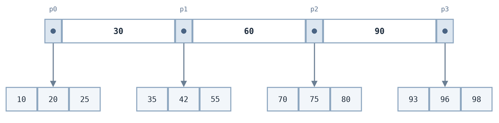

Burada üç anahtar için 4 alt düğümün bulundurulduğuna dikkat ediniz. Arama yapılırken aranacak değer hangi anahtarlar
arasında kalıyorsa o alt düğüme gidilmektedir. Örneğin burada ``75`` değerinin arandığını varsayalım. Bu değer ``60``
anahtarı ile ``90`` anahtarı arasındadır. Bu durumda ``p2`` göstericisinin gösterdiği alt düğüme gidilecektir:

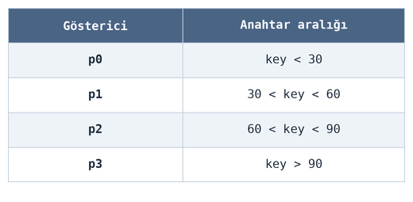

Gerçekleştirimde tipik olarak anahtarlar ve düğümler birer dizi içerisinde tutulmaktadır. 

Çekirdeğin prosesin *VMA*'ları üzerindeki şu iki işlemi etkin biçimde yapabilmesi gerekir:

| **1.** Belli bir adresin tahsis edilmiş bir *VMA* içerisinde olup olmadığının belirlenmesi. Örneğin bir gösterici ile bir
   adrese erişilmiş olsun. Bu sanal adrese ilişkin sayfa tablosunda bir yönlendirme yapılmadıysa *sayfa hatası (page
   fault)* oluşacaktır. Bu sayfa hatasına ilişkin kesme kodunda işletim sisteminin erişilen yerin programın sanal
   adres alanı içerisinde geçerli bir yer olup olmadığını tespit etmesi gerekir.

| **2.** İşletim sisteminin tahsis edilmiş tüm *VMA*'ları dolaşabilmesi gerekir. Burada bir arama değil dolaşma söz konusudur.

Eskiden daha önce de belirttiğimiz arama amacıyla *kırmızı-siyah ağacı* ve dolaşma amacıyla da bir bağlı liste
kullanılıyordu. Örneğin çekirdeğin eski versiyonlarında ``mm_struct`` nesnesinin ilgili elemanları şöyleydi:

.. code-block:: c

    struct mm_struct {
        /* ... */
        struct vm_area_struct *mmap;    /* list of VMAs */
        struct rb_root mm_rb;
        /* ... */
    };

Burada ``mm_rb`` elemanı *VMA*'ların tutulduğu kırmızı-siyah arama ağacının kökünü, ``mmap`` elemanı ise *VMA*'ları
dolaşmakta kullanılan bağlı listenin kökünü belirtmektedir. Bu bağlı listenin düğümleri doğrudan ``vm_area_struct``
nesnelerinden oluşmaktadır. ``vm_area_struct`` yapısındaki ``vm_next`` göstericisi de sonraki elemanı göstermektedir.
Ancak bu tasarım yukarıda da belirttiğimiz gibi çekirdeğin 6.1 versiyonunda (2022) değiştirilmiş ve *maple ağacı*
kullanılmaya başlanmıştır. Maple ağacının kendisi dolaşıma da izin verdiği için artık ayrı bir listeye gerek de
kalmamıştır.

Maple ağacı bu bakımdan B-Tree organizasyonunun benzerini kullanmaktadır. Ancak anahtarlar yerine sanal bellek adresleri
bulunmaktadır. Çünkü *VMA*'lar için kullanılan bu ağacın amacı tek bir anahtar tutmak değil bir adres aralığı tutmaktır.
Maple ağacında her zaman adres alanları ardışıl bir biçimde tutulmaktadır. Güncel çekirdeklerde ``mm_struct``
içerisindeki maple ağacının kökü ``maple_tree`` isimli bir yapıyla temsil edilmiştir:

.. code-block:: c

    struct mm_struct {
        /* ... */
        struct maple_tree mm_mt;    /* Maple ağacı */
        int map_count;              /* VMA sayısı */
        /* ... */
    };

``mm_struct`` yapısının ``mm_mt`` elemanı maple ağacını temsil etmektedir. ``map_count`` elemanı prosesin sanal bellek
alanında toplam kaç *VMA* (``vm_area_struct``) olduğunu belirtmektedir. ``maple_tree`` yapısı güncel çekirdeklerde
``include/linux/maple_tree.h`` başlık dosyası içerisinde şöyle tanımlanmıştır:

.. code-block:: c

    struct maple_tree {
        union {
            spinlock_t ma_lock;
    #ifdef CONFIG_LOCKDEP
            struct lockdep_map *ma_external_lock;
    #endif
        };
        unsigned int ma_flags;
        void __rcu *ma_root;
    };

Burada ``ma_lock`` elemanı erişimler için kullanılan spinlock nesnesini, ``ma_root`` elemanı ise kök düğümün yerini
belirtmektedir. Maple ağacının düğümlerini temsil eden yapı da ``include/linux/maple_tree.h`` başlık dosyası içerisinde
şöyle tanımlanmıştır:

.. code-block:: c

    struct maple_node {
        union {
            struct {
                struct maple_pnode *parent;
                void __rcu *slot[MAPLE_NODE_SLOTS];
            };
            struct {
                void *pad;
                struct rcu_head rcu;
                struct maple_enode *piv_parent;
                unsigned char parent_slot;
                enum maple_type type;
                unsigned char slot_len;
                unsigned int ma_flags;
            };
            struct maple_range_64 mr64;
            struct maple_arange_64 ma64;
            struct maple_copy cp;
        };
    };

Görüldüğü gibi ``maple_node`` yapısı aslında çakışık yapılardan oluşan bir birlik görünümündedir. Yukarıdaki yapının
içerisinde bulunan birliğin içerisindeki yapılar (anonymous struct) ve yapı nesneleri çakışıktır. Örneğin aşağıdaki üç
eleman aynı anda bulunmamaktadır:

.. code-block:: c

    struct maple_range_64 mr64;
    struct maple_arange_64 ma64;
    struct maple_copy cp;

Peki bu kadar çakışıklığın nedeni nedir? İşte bu çakışıklık tek bir düğüm veri yapısının çeşitli konfigürasyonlara göre
değiştirilebilirliğini sağlamaktadır.

Güncel çekirdeklerdeki maple ağacının düğümlerindeki gösterici sayısı (slot da denilmektedir) konfigürasyon
parametresine göre değişebilmektedir. 64 bit sistemlerde şöyledir:

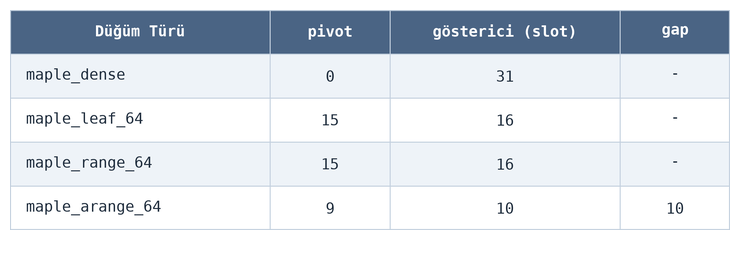

32 bit sistemlerde ise şöyledir:

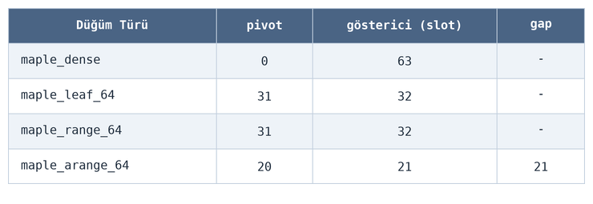

Burada pivot sözcüğü anahtar anlamında kullanılmaktadır. pivot sayısının gösterici sayısından (slot sayısından) bir
eksik olduğuna dikkat ediniz. Çekirdek kodlarında kullanılan slot sayısına ilişkin makrolar şunlardır:

.. code-block:: c

    #if defined(CONFIG_64BIT) || defined(BUILD_VDSO32_64)
    #define MAPLE_NODE_SLOTS        31  /* 256 bytes including ->parent */
    #define MAPLE_RANGE64_SLOTS     16  /* 256 bytes */
    #define MAPLE_ARANGE64_SLOTS    10  /* 240 bytes */
    #else
    #define MAPLE_NODE_SLOTS        63  /* 256 bytes including ->parent */
    #define MAPLE_RANGE64_SLOTS     32  /* 256 bytes */
    #define MAPLE_ARANGE64_SLOTS    21  /* 240 bytes */
    #endif

Maple ağacı genel biçimde tasarlanmıştır. Maple ağacındaki düğümler farklı bilgileri taşıyabilmektedir. Düğümün içeriği
onun türüne bağlı olarak değişmektedir. Düğüm türleri de aşağıdaki ``enum`` yapısıyla belirtilmiştir:

.. code-block:: c

    enum maple_type {
        maple_dense,
        maple_leaf_64,
        maple_range_64,
        maple_arange_64,
        maple_copy,
    };

Düğümlerin tür bilgisi düğümün içinde değil, onu gösteren göstericinin (encoded node, ``maple_enode``) düşük anlamlı
bitlerinde kodlanmaktadır. *VMA*'lar için oluşturulan ve şu anda ele aldığımız maple ağaçlarında yalnızca iki farklı
düğüm türü bulunmaktadır:

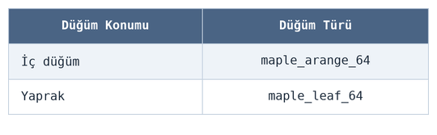

Maple ağacı gerçekleştiriminde yaprak düğümlerdeki slotlarda (yani göstericilerde) *VMA* nesnelerinin adresleri
tutulmaktadır. Maple ağaçları B-Tree türevi olduğu için tüm yapraklar aynı derinliktedir. Yapraklardaki bir slotun
(göstericinin) ``NULL`` olması ilgili aralığın tahsis edilmediğini yani boş olduğunu belirtmektedir. ``NULL`` slot
yalnızca yapraklarda bulunabilir. Bir ara düğümde bir alt aralık "burası boş" biçiminde ``NULL`` gösterici ile
belirtilemez. O aralık da bir alt düğümle temsil edilmek zorundadır. Aralık ne kadar büyük olursa olsun, en altta onu
kaplayan bir yaprak ve o yaprakta bir ``NULL`` gösterici bulunmaktadır. Tabii bir düğümün tüm slotları dolu olmak
zorunda da değildir. Bir düğümün son geçerli slotunun indeksi ara düğümler için ``maple_node`` yapısı içerisindeki
``maple_arange_64`` yapısının ``maple_metadata`` türünden elemanında, yaprak düğümler için ``maple_node`` yapısı
içerisindeki ``maple_range_64`` yapısının ``maple_metadata`` türünden elemanında tutulmaktadır.

Düğümlerin çakışık iki ayrı yapı ile temsil edildiğine dikkat ediniz: ``maple_arange_64`` ve ``maple_range_64``. *VMA*
ağaçlarında ara düğümler ``maple_arange_64`` elemanını kullanırken yaprak düğümler ``maple_range_64`` elemanını
kullanmaktadır. Yani düğümün türü ``maple_arange_64`` ise yapının ``maple_arange_64`` elemanı, düğümün türü
``maple_leaf_64`` ise yapının ``maple_range_64`` elemanı kullanılmaktadır. Yukarıda da belirttiğimiz gibi zaten *VMA*
için oluşturulan maple ağaçlarında başka türden düğümler bulunmamaktadır. ``maple_range_64`` yapısıyla
``maple_arange_64`` yapısının tanımlamalarını aşağıda veriyoruz:

.. code-block:: c

    struct maple_range_64 {
        struct maple_pnode *parent;
        unsigned long pivot[MAPLE_RANGE64_SLOTS - 1];
        union {
            void __rcu *slot[MAPLE_RANGE64_SLOTS];
            struct {
                void __rcu *pad[MAPLE_RANGE64_SLOTS - 1];
                struct maple_metadata meta;
            };
        };
    };

    struct maple_arange_64 {
        struct maple_pnode *parent;
        unsigned long pivot[MAPLE_ARANGE64_SLOTS - 1];
        void __rcu *slot[MAPLE_ARANGE64_SLOTS];
        unsigned long gap[MAPLE_ARANGE64_SLOTS];
        struct maple_metadata meta;
    };

``maple_arange_64`` yapısında bir ``gap`` alanı olduğuna dikkat ediniz. Bu ``gap`` alanı alt düğümlerdeki yani her
slotun gösterdiği alt ağaçtaki en büyük boş (``NULL``) aralığın uzunluğunu tutan bir dizidir. Böylece tahsisat için
arama yapılırken eğer alt ağaçta yeteri kadar yer yoksa boşuna aşağıya doğru gidilmemektedir.

Yukarıda düğümlerin türlerinin slot içerisindeki göstericilerde saklandığını belirtmiştik. Bu göstericilerin gösterdiği
yerdeki düğüm nesneleri belli uzunluklara hizalanmıştır. Buradaki slot göstericilerinin formatı şöyledir:

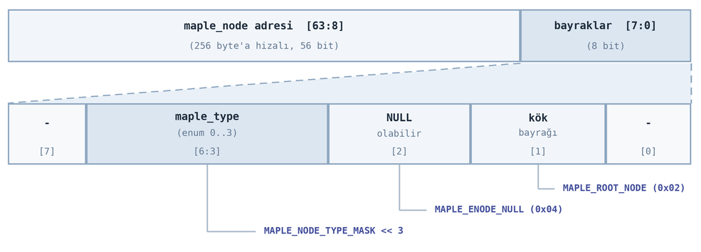

Görüldüğü gibi alt düğümlerin yerlerini belirten göstericilerin düşük anlamlı 8 biti bayraklar için ayrılmıştır. Maple
ağacının düğümleri de 256 byte'a hizalanmış durumdadır. Düşük anlamlı 8 bitin ``[6:3]`` bitleri (toplam 4 bit) alt
düğümün türünü tutmaktadır. Yani bu değer sağa 3 kez ötelenirse yukarıda verdiğimiz ``enum`` değerleri elde
edilmektedir:

.. code-block:: c

    enum maple_type {
        maple_dense,
        maple_leaf_64,
        maple_range_64,
        maple_arange_64,
        maple_copy,
    };

Bir byte'lık alan içerisindeki değerleri de aşağıdaki tabloda belirtiyoruz:

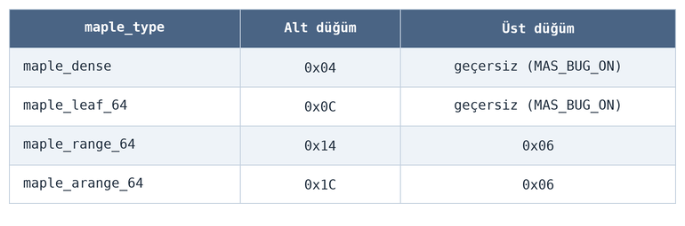

Burada üçüncü sütuna dikkat ediniz. B-Tree gerçekleştirimlerinde üst düğümün yeri tutulmak zorundadır. İşte üst
düğümün yeri de aynı zamanda ``parent`` göstericisinde tür bilgisiyle tutulmaktadır. Üçüncü sütun bu ``parent``
göstericisine ilişkindir. Üst düğüm göstericisinin bayraklarını şöyle de gösterebiliriz:

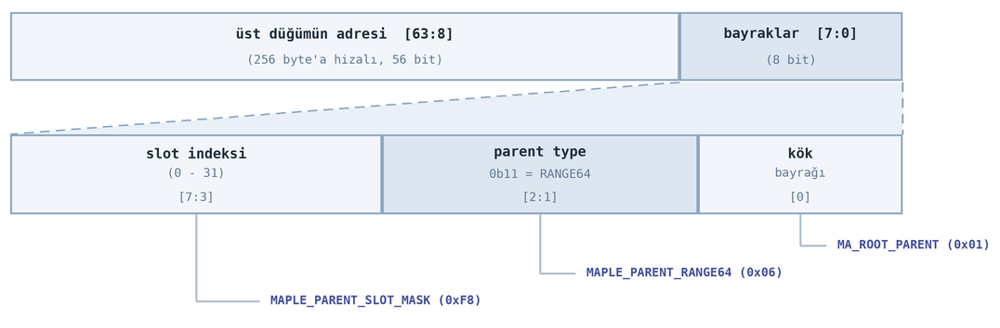

Yukarıda da belirttiğimiz gibi arama sonucunda yapraklara inilip *VMA* nesnelerinin adresleri yapraklardaki slotlardan
elde edilmektedir. Yaprak düğümlerdeki slotlarda bulunan adreslerin düşük anlamlı 8 biti her zaman ``0``'dır. Bu
slottaki adres artık doğrudan ``vm_area_struct`` nesnesini göstermektedir. Burada temsili bir adresle durumu şekilsel
olarak gösterelim:

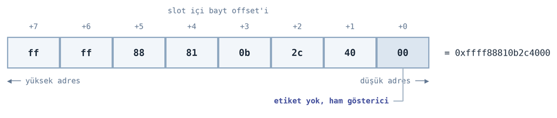

Üst düğümü gösteren parent göstericisinin içeriisndeki adres de aşağıdakine benzemektedir:

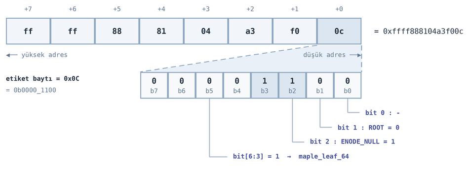

Maple ağacında her zaman prosesin tüm adres alanı kesiksiz tutulmaktadır. Yani prosesin adres alanında dolu ya da boş
her alan maple ağacının kökünden girilip yapraklara kadar ilerlendiğinde yapraklarda bulunmaktadır.

Şimdi maple ağacının görünümünü kafanızda canlandırabilmeniz için bazı örnekler verelim. Aşağıda en alt düzeydeki bir
yaprak düğümü görüyorsunuz:

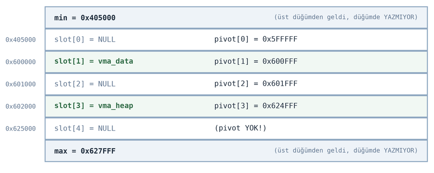

Bu düğümden ne anlaşılmaktadır? Bu düğüm ``0x405000`` ile ``0x627FFF`` arasındaki bölgeyi tutmaktadır. ``pivot[0]``
değerinin ``0x5FFFFF`` olduğuna ve ``slot[0]``'ın ``NULL`` adres içerdiğine dikkat ediniz. Bu durumda ``0x405000`` ile
``0x5FFFFF`` arasındaki bölge sanal adres alanında tahsis edilmemiştir. ``pivot[1]`` değerinin ``0x600FFF`` olduğuna
dikkat ediniz. İşte ``0x600FFF`` ile ``0x601FFF`` arasındaki bölge tahsis edilmiştir ve o bölgeyi belirten *VMA*
``slot[1]`` tarafından gösterilmektedir. ``pivot[2]`` değerinin ``0x601FFF`` olduğuna ve buna karşı gelen
``slot[2]``'nin ``NULL`` adres içerdiğine dikkat ediniz. Bu durumda ``0x601FFF`` ile ``0x624FFF`` arasındaki bölge
boştur. İşte bu düğüm belli bir sanal adres aralığının durumunu yansıtmaktadır.

Şimdi de boş bir sanal adres alanına *VMA*'lar eklendiğinde maple ağacının bu alanları nasıl gösterdiğine ilişkin bir
örnek verelim. Çekirdekte kullanılan maple ağacının düğümlerinde 16 slot bulunmaktadır. Ancak biz örneğimizde ağacın
kolay anlaşılabilmesi için düğümlerdeki slot sayısının 3 olduğunu varsayacağız.

Örneğin başlangıçta çekirdekteki ``mtree_store_range`` fonksiyonu ile aşağıdaki aralığın tahsis edildiğini düşünelim:

.. code-block:: c

    mtree_store_range(&mm_mt, 0x400000, 0x400FFF, vma_text, GFP_KERNEL);

Prosesin sanal adres alanının sembolik görüntüsü şöyledir:

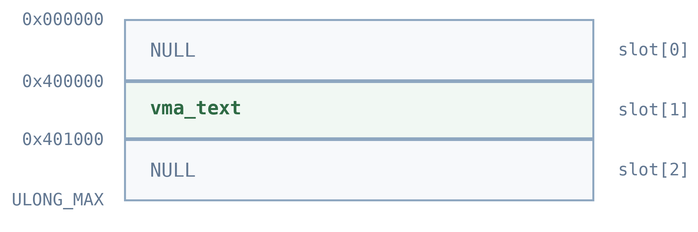

Burada kök düğümdeki üç slot şöyledir:

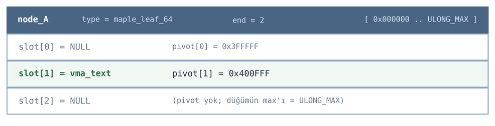

Şimdi prosesin adres alanına ``vma_data`` ile isimlendirdiğimiz yeni bir *VMA* ekleyelim:

.. code-block:: c

    mtree_store_range(&mm_mt, 0x600000, 0x600FFF, vma_data, GFP_KERNEL);

Şimdi prosesin sanal adres alanının görünümü şöyle olacaktır:

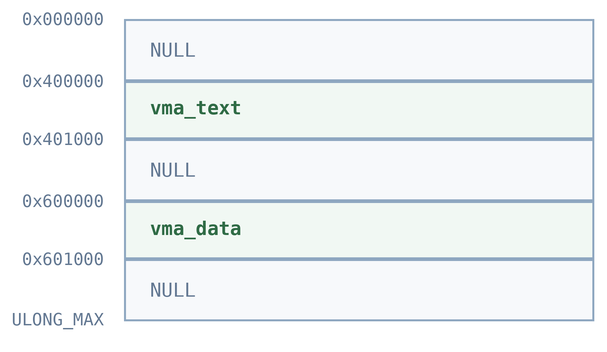

Bizim örneğimizde slot sayısı üç olduğu için artık buradaki 5 bölge 3 slota sığmayacağından alt düğüm
oluşturulacaktır:

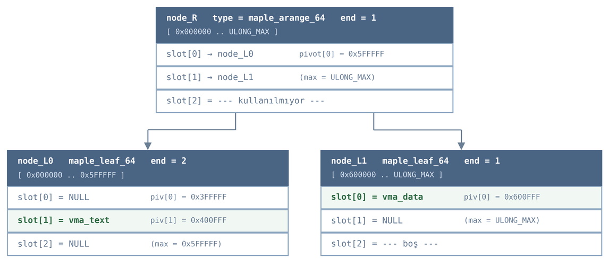

Şimdi prosesin adres alanına ``vma_heap`` ile temsil ettiğimiz bir *VMA* daha ekleyelim:

.. code-block:: c

    mtree_store_range(&mm_mt, 0x602000, 0x624FFF, vma_heap, GFP_KERNEL);

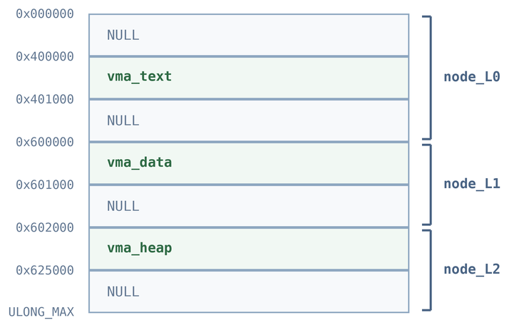

Bu eklemeden sonra maple ağacının görünümü şöyle olacaktır:

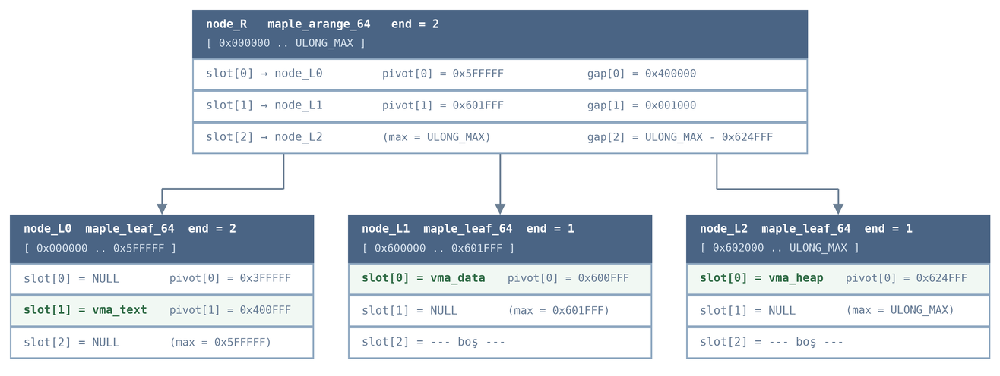

Biz örneğimizde düğümlerdeki slot sayısını (yani ``MT_SLOTS`` değerini) 3 yaptığımız için üç *VMA* eklemekle iki bölünme
yaşadık. Gerçekte ``MAPLE_RANGE64_SLOTS`` = 16'dır ve bir yaprak, aralarındaki ``NULL`` aralıklarla birlikte yaklaşık 8
*VMA* taşımaktadır. Tipik bir prosesin yaklaşık 100 *VMA*'sı için ağaç yüksekliği 2'de kalır; bölünme yalnızca yüzlerce
*VMA*'lı proseslerde ara sıra olmaktadır.

Şimdi yine düğümlerde 3 slot içeren bir maple ağacı örneği daha verelim. Prosesin sanal bellek alanı şöyle olsun:

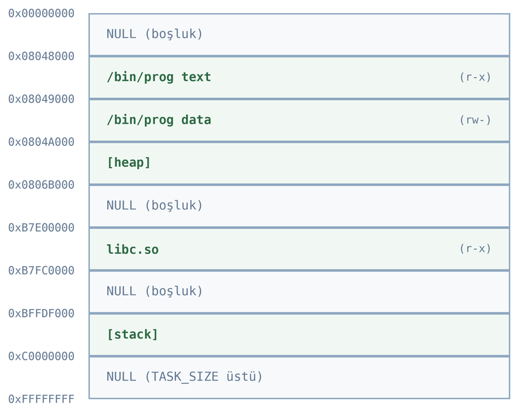

Buradaki maple ağacı şu biçimde oluşturulacaktır:

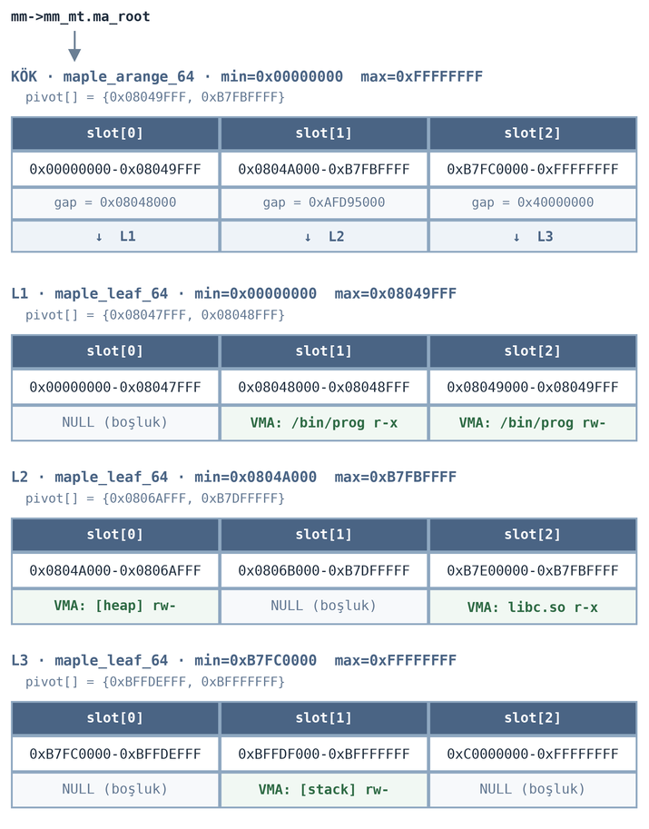

Yukarıda biz maple ağacının bazı ayrıntılarına değindik. Ancak ayrıntıların büyük resmi bulanıklaştırmasını engellemek
için maple ağacının ne işe yaradığını ve hangi işlevler için bulundurulduğunu özetlemek istiyoruz:

- Maple ağacı prosesin bellek alanı içerisindeki *VMA*'ların yerlerini tutmaktadır.

- Maple ağacı sayesinde belli bir adresin prosesin bellek alanı içerisinde tahsis edilmiş bir *VMA* içerisinde olup
  olmadığı hızlı bir biçimde sorgulanabilmektedir.

- Maple ağacı prosesin sanal bellek alanında yeni bir *VMA* tahsisatı yapılırken boş alanların hızlı bir biçimde tespit
  edilmesini sağlamaktadır.

- Maple ağacı sayesinde artık prosesin bütün *VMA*'larının ayrı bir listede saklanmasına da gerek kalmamaktadır.

Prosesin sanal bellek alanı ile işlemcinin o proses için kullandığı sayfa tablosunu birbirine karıştırmayınız. Bir
program dosyası ``exec`` fonksiyonlarıyla yüklendiğinde ELF formatındaki bölümlerden (segments) hareketle prosesin sanal
bellek alanında *VMA*'lar (yani ``vm_area_struct`` nesneleri) oluşturulmaktadır. Ancak ``exec`` işlemi sonrasında
prosesin sayfa tablosu hemen hemen boş durumdadır. Prosesin sayfa tablosunda sanal sayfalara karşı fiziksel sayfaların
oluşturulması işlemi *sayfa hatası (page fault)* ile yapılmaktadır. Bir sayfa hatası (page fault) oluştuğunda
işletim sistemi hataya yol açan adresi inceler. Bu adresin prosesin sanal bellek alanında bir *VMA* tarafından
gösterilip gösterilmediğini maple ağacını kullanarak tespit eder. Eğer erişilmek istenen adres sanal bellek alanı
içerisindeyse bu durumda erişilen bölgeyi diskten belleğe yükler. Yani görüldüğü gibi maple ağacının işlevi *VMA*'nın
bulunmasından ibarettir. Bu sayfanın fiziksel RAM'e yüklenmesi *VMA* nesnesinden (yani ``vm_area_struct`` nesnesinden)
hareketle yapılmaktadır.

VMA'lar İle İlgili İşlem Yapan Çekirdek Fonksiyonları
=====================================================

Bu başlıkta  *VMA*'lar üzerinde işlem yapan temel çekirdek fonksiyonlarından bahsedeceğiz. Ancak maple ağacı üzerinde işlem 
yapan fonksiyonları ele almayacağız.

*VMA* nesnelerinin tahsisatına ilişkin temel çekirdek fonksiyonları şunlardır:

.. code-block:: c

    struct vm_area_struct *vm_area_alloc(struct mm_struct *mm);
    struct vm_area_struct *vm_area_dup(struct vm_area_struct *orig);
    void vm_area_free(struct vm_area_struct *vma);
    void vma_init(struct vm_area_struct *vma, struct mm_struct *mm);

- ``vm_area_alloc``: ``vm_area_cachep`` dilim önbelleğinden bir *VMA* nesnesi tahsis eder ve ``vma_init`` ile ilk
  değerlerini verir, ancak ağaca eklemez.

- ``vm_area_dup``: Var olan bir *VMA* nesnesinin kopyasını oluşturur. Bölme ve ``fork`` işlemlerinde kullanılır.

- ``vm_area_free``: *VMA* nesnesini serbest bırakır (per-VMA kilit kullanılan sistemlerde RCU gecikmesiyle).

- ``vma_init``: *VMA* nesnesini sıfırlar, ``vm_mm`` alanını ayarlar ve per-VMA kilidini hazırlar.

Bu fonksiyonlar ``mm/vma_init.c`` dosyasında tanımlanmıştır.

Ağaca ekleme yapan fonksiyonlar şunlardır:

.. code-block:: c

    int insert_vm_struct(struct mm_struct *mm, struct vm_area_struct *vma);
    int vma_link(struct mm_struct *mm, struct vm_area_struct *vma);

- ``insert_vm_struct``: Hazırlanmış bir *VMA*'yı adres alanına ekler. Aralığın boş olduğunu ve bellek sınırlarını
  denetler, ardından ``vma_link`` çağırır. Örneğin ``exec`` sırasında ilk yığın *VMA*'sı bu yolla eklenir.

- ``vma_link``: *VMA*'yı maple ağacına yazar, eğer *VMA* dosya tabanlıysa ``i_mmap`` ağacına bağlar ve ``mm->map_count``
  değerini artırır.

Bölme, birleştirme, genişletme ve daraltma yapan fonksiyonlar şunlardır:

.. code-block:: c

    int split_vma(struct vma_iterator *vmi, struct vm_area_struct *vma,
            unsigned long addr, int new_below);
    struct vm_area_struct *vma_merge_new_range(struct vma_merge_struct *vmg);
    int vma_expand(struct vma_merge_struct *vmg);
    int vma_shrink(struct vma_iterator *vmi, struct vm_area_struct *vma,
            unsigned long start, unsigned long end, pgoff_t pgoff);

- ``split_vma``: *VMA*'yı ``addr`` adresinden ikiye böler. ``new_below`` sıfırdan farklıysa yeni *VMA* alt parçayı,
  sıfırsa üst parçayı oluşturur. Yeni parça ``vm_area_dup`` ile oluşturulur ve iki parça maple ağacına yeni sınırlarıyla
  yazılır.

- ``vma_merge_new_range``: Henüz *VMA*'sı olmayan yeni bir aralığın komşu *VMA*'larla (önceki ve/veya sonraki)
  birleştirilip birleştirilemeyeceğine bakar. Birleştirilebiliyorsa yeni *VMA* oluşturmadan komşuyu genişletir ve onu
  döndürür. Birleştirilemiyorsa ``NULL`` döndürür.

- ``vma_expand``: Bir *VMA*'yı (gerekirse sonraki *VMA*'yı yutarak) daha büyük bir aralığa genişletir ve ağacı
  günceller.

- ``vma_shrink``: Bir *VMA*'yı ``[start, end)`` aralığına daraltır. Dışarıda kalan kısım ağaçtan temizlenir.

*VMA*'nın özelliklerini değiştiren ``vma_modify_flags`` isimli bir fonksiyon bulunmaktadır:

.. code-block:: c

    struct vm_area_struct *vma_modify_flags(
            struct vma_iterator *vmi, struct vm_area_struct *prev,
            struct vm_area_struct *vma, unsigned long start,
            unsigned long end, unsigned long new_flags);

- Bu fonksiyon *VMA*'nın ``[start, end)`` kısmının bayraklarını değiştirmek için gereken yapısal işlemleri yapar: Önce
  komşularla birleştirmeyi dener. Birleştirme olmazsa ve gerekiyorsa *VMA*'yı bir ya da iki yerinden böler. Bayrakların
  değiştirileceği *VMA*'yı döndürür (bayrakların kendisini çağıran ayarlar). Benzer amaçlı ``vma_modify_policy``,
  ``vma_modify_flags_name`` ve ``vma_modify_flags_uffd`` fonksiyonları da vardır.

Aşağıdaki fonksiyonlar *VMA* için alan eşlemektedir:

.. code-block:: c

    unsigned long get_unmapped_area(
            struct file *file, unsigned long addr,
            unsigned long len, unsigned long pgoff,
            unsigned long flags);

    unsigned long vm_unmapped_area(struct vm_unmapped_area_info *info);

    unsigned long mmap_region(
            struct file *file, unsigned long addr,
            unsigned long len, vm_flags_t vm_flags,
            unsigned long pgoff, struct list_head *uf);

- ``get_unmapped_area``: Yeni eşleme için uygun bir sanal adres seçer. Dosyanın, mimarinin ya da ``mm`` nesnesinin kendi
  ``get_unmapped_area`` fonksiyonuna yönlendirir.

- ``vm_unmapped_area``: ``info`` ile belirtilen kısıtlara (uzunluk, alt/üst sınır, hizalama, yön) göre boş alan arar.
  İçeride ``mas_empty_area`` ya da ``mas_empty_area_rev`` kullanır.

- ``mmap_region``: Seçilen adreste eşlemeyi gerçekten oluşturur: Aralıkta eski eşleme varsa onu kaldırır,
  ``vma_merge_new_range`` ile birleştirmeyi dener, olmazsa ``vm_area_alloc`` ile yeni *VMA* oluşturup ağaca yazar ve
  dosyanın ``mmap`` mekanizmasını kullanır.

Eşlemeleri kaldırmak için aşağıdaki fonksiyonlar bulundurulmuştur:

.. code-block:: c

    int do_munmap(
            struct mm_struct *mm, unsigned long start,
            size_t len, struct list_head *uf);

    int do_vmi_munmap(
            struct vma_iterator *vmi, struct mm_struct *mm,
            unsigned long start, size_t len,
            struct list_head *uf, bool unlock);

    int do_vmi_align_munmap(
            struct vma_iterator *vmi, struct vm_area_struct *vma,
            struct mm_struct *mm, unsigned long start,
            unsigned long end, struct list_head *uf,
            bool unlock);

- ``do_munmap``: ``[start, start + len)`` aralığındaki eşlemeleri kaldırır. Kendi dolaşıcısını (iterator) oluşturup
  ``do_vmi_munmap`` çağırır.

- ``do_vmi_munmap``: Aralığı sayfa sınırına hizalar, aralıktaki ilk *VMA*'yı bulur ve ``do_vmi_align_munmap`` çağırır.
  ``unlock`` ``true`` ise işin sonunda yazma kilidi okuma kilidine düşürülür.

- ``do_vmi_align_munmap``: Asıl işi yapar: Aralığın uçlarındaki *VMA*'ları gerekirse böler, aradaki *VMA*'ları ayrı bir
  yan ağaçta (detached tree) toplar, ana ağaçtan aralığı temizler, ardından sayfa tablolarını ve *VMA*'ları serbest
  bırakır.

Linux 6.12 ile bu işlem ``vms_gather_munmap_vmas`` ve ``vms_complete_munmap_vmas`` adımlarına (``struct vma_munmap_struct``) 
ayrılmıştır. Ancak dışarıdan çağrılan fonksiyonlar aynı kalmıştır.

*VMA* araması yapan temel fonksiyonlar şunlardır:

.. code-block:: c

    struct vm_area_struct *find_vma(struct mm_struct *mm, unsigned long addr);
    struct vm_area_struct *vma_lookup(struct mm_struct *mm, unsigned long addr);
    struct vm_area_struct *find_vma_prev(struct mm_struct *mm, unsigned long addr,
            struct vm_area_struct **pprev);
    struct vm_area_struct *find_vma_intersection(struct mm_struct *mm, unsigned long start_addr,
            unsigned long end_addr);
    struct vm_area_struct *lock_vma_under_rcu(struct mm_struct *mm, unsigned long address);
    struct vm_area_struct *lock_mm_and_find_vma(struct mm_struct *mm, unsigned long address,
            struct pt_regs *regs);

- ``find_vma``: ``vm_end > addr`` koşulunu sağlayan ilk *VMA*'yı döndürür. Dönen *VMA* ``addr`` adresini içermeyebilir
  (``addr`` bir boşluktaysa, boşluğun üstündeki *VMA* döner).

- ``vma_lookup``: Yalnızca ``addr`` adresini içeren *VMA*'yı döndürür. Yoksa ``NULL`` döndürür. İçeride ``mtree_load``
  kullanır.

- ``find_vma_prev``: ``find_vma`` ile aynı *VMA*'yı döndürür. Ayrıca ondan önceki *VMA*'yı ``*pprev`` ile verir.

- ``find_vma_intersection``: ``[start_addr, end_addr)`` aralığıyla kesişen ilk *VMA*'yı döndürür.

- ``lock_vma_under_rcu``: ``mmap_lock`` almadan, RCU altında maple ağacında arama yapar ve bulduğu *VMA*'nın per-VMA
  okuma kilidini almaya çalışır. Başarısız olursa ``NULL`` döner ve çağıran ``mmap_lock`` yoluna geçer. Sayfa
  hatalarının hızlı yoludur.

- ``lock_mm_and_find_vma``: ``mmap_read_lock`` alarak *VMA*'yı bulur. Adres bir yığın (stack) *VMA*'sının hemen
  altındaysa yığını genişletmeyi de dener. 

Proseslerin Heap Alanlarının Organizasyonu
==========================================

Şimdi de proseslerin heap alanlarının nasıl organize edildiği üzerinde duralım. Anımsanacağı gibi *heap alanı* dinamik
tahsisatların yapıldığı deposal bir alandır. Pek çok modern işletim sisteminde heap alanı prosese özgü bir biçimde
prosesin sanal bellek alanı içerisinde oluşturulmaktadır. Bu nedenle proses sonlandığında prosesin heap alanı da yok
edilmektedir. (Ancak C standartlarında bellek tahsisat fonksiyonlarının prosese özgü bir alanda tahsisat yaptığına
ilişkin bir açıklamada bulunulmamıştır. Yani C standartlarında ``malloc`` gibi tahsisat fonksiyonlarının prosese özgü
bir biçimde tahsisat yapması garanti edilmiş bir davranış değildir.)

Linux çekirdeğinde prosesin heap alanı başlangıçta sabit uzunluklu biçimde belirlenmiş bir alan değildir. Heap alanı
belli bir yerden başlatılarak gerektikçe aşağıya doğru (düşük adresten yüksek adrese doğru) büyütülmektedir. Heap alanı
için de bir ya da birden fazla *VMA* (``vm_area_struct``) nesnesi oluşturulmaktadır. Neden heap alanının başlangıçta
belli büyüklükte yaratılmadığını merak edebilirsiniz. Eğer böyle olsaydı o alanın tamamı için bir *VMA* oluşturulurdu ve
henüz tahsis edilmemiş heap alanlarına yapılan erişimler sayfa hatası (page fault) sırasında tespit edilemezdi. Ayrıca
heap için baştan yer ayrılması izleyen bölümde açıklayacağımız ``mmap`` alanı üzerinde de gereksiz bir baskı
oluşturabilirdi. Aşağıdaki şekilde 32 bit sistemlerde heap alanının prosesin bellek alanındaki konumu betimlenmektedir:
 
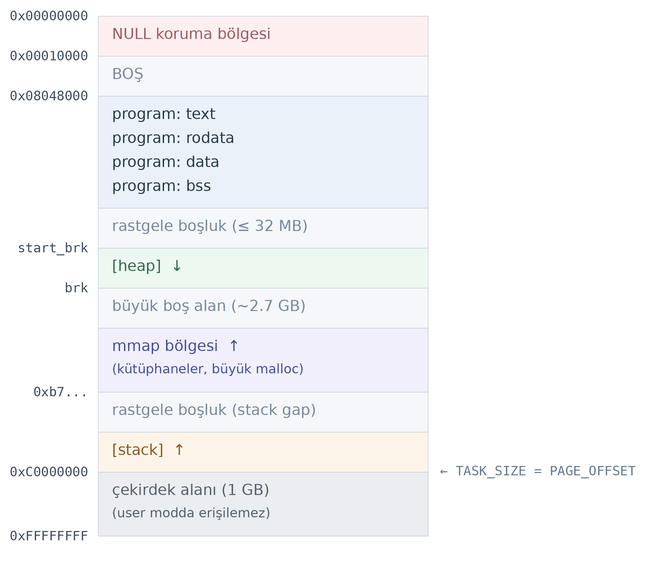

64 bit sistemlerde de benzer organizasyon söz konusudur:

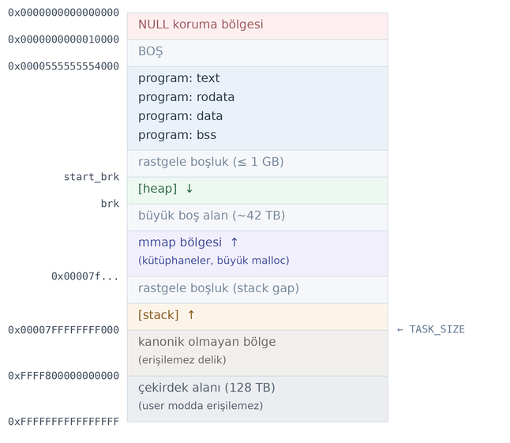

Burada prosesin sanal bellek alanının ilk 64K'lık kısmının NULL adres atamalarının tespiti için kullanıldığını
görüyorsunuz. Belli bir boşluktan sonra ELF formatının bölümlerinin yüklendiği alanlar gelmektedir. ELF formatının
yerleşik alanlarından sonra heap alanının başlangıcını kötü niyetli yazılımların bulmasını zorlaştırmak için rastgele
bir boşluk bulundurulmaktadır. Bu rastgele boşluktan sonra heap alanı başlamaktadır. Heap alanının büyütülmesi aşağıya
doğru, ``malloc``, ``calloc``, ``realloc`` çağrılarında heap alanı yetmediği zaman ``brk`` ve ``sbrk`` isimli
fonksiyonlarla yapılmaktadır. Bu fonksiyonlar doğrudan Linux sistemlerinde ``sys_brk`` isimli sistem fonksiyonunu
çağırmaktadır. Ancak ``brk`` ve ``sbrk`` fonksiyonları POSIX standartlarında bulunmamaktadır. Tabii heap büyüdükçe ya da
küçüldükçe heap alanına ilişkin *VMA*'lar da güncellenmektedir. UNIX dünyasında geleneksel olarak tahsis edilmiş heap 
alanının bittiği noktaya *program break address* de denilmektedir. Başlangıç durumunda heap alanı 0 uzunluktadır. 
Yani *program break address* rastgele boşluktan hemen sonrayı göstermektedir. (Başka bir deyişle ``start_brk`` 
ile ``brk`` adresleri aynıdır.) ``malloc`` gibi tahsisatlar yapıldıkça heap alanı
büyütülmektedir.

Yukarıdaki çizimlerde heap bölgesinin başlangıç sanal bellek adresi ``start_brk`` ile bitiş sanal bellek adresi de
``brk`` ile gösterilmiştir. İşte ``malloc`` gibi bir tahsisat fonksiyonu yeterli alanı bulamayınca bu ``brk`` adresini
``brk`` ya da ``sbrk`` fonksiyonlarıyla aşağıya kaydırarak heap alanını büyütmekte ve büyüyen alanı da heap
organizasyonuna dahil etmektedir. ``brk`` ve ``sbrk`` fonksiyonları kullanıcı modundan kullanılabilmektedir.
Fonksiyonların prototipleri şöyledir:

.. code-block:: c

    #include <unistd.h>

    int brk(void *addr);
    void *sbrk(intptr_t increment);

``brk`` fonksiyonu heap alanının yeni bitiş noktasını adres olarak almaktadır. ``sbrk`` fonksiyonu ise bu break adresini
belirlenen miktarda artırmakta ya da azaltmaktadır. ``sbrk`` fonksiyonu 0 argümanı ile çağrılırsa o andaki break adresi
elde edilebilir. ``brk`` fonksiyonu başarı durumunda 0 değerine, başarısızlık durumunda -1 değerine geri dönmektedir.
``sbrk`` fonksiyonu ise başarı durumunda yeni break adresine, başarısızlık durumunda ``(void *)-1`` değerine (başka bir
deyişle en yüksek adres değerine) geri dönmektedir.

``brk`` ve ``sbrk`` fonksiyonları her ne kadar Linux sistemlerinde kullanıcı modundan çağrılabilir durumdaysa da
programcının bu fonksiyonları çağırması tavsiye edilmemektedir. Bu fonksiyonlar ``malloc``, ``realloc`` gibi tahsisat
fonksiyonları tarafından çağrılmaktadır. Biz örneğin ``sbrk`` fonksiyonu ile heap alanını küçültürsek bu ``sbrk``
fonksiyonu (``sys_brk`` sistem fonksiyonu) ``malloc`` ile yapılan tahsisatları bilmediği için C'nin tüm tahsisat
sisteminin bozulmasına yol açabilir.

Peki heap alanı en fazla ne kadar büyüyebilir? İşte break adresi aşağıya doğru, izleyen paragraflarda göreceğimiz
``mmap`` alanı da yukarı doğru büyümektedir. Bunların arasına da en az 1 sayfa boşluk bırakılmaktadır. Bunların
kesiştiği noktada artık heap ve ``mmap`` alanları daha fazla büyütülemeyecektir:

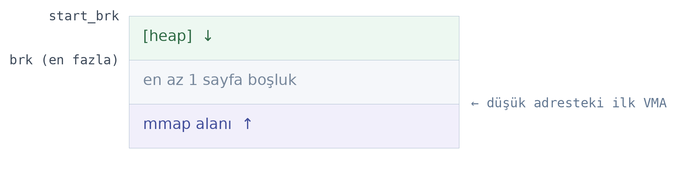

UNIX türevi sistemlerde ``malloc`` ve ``realloc`` fonksiyonları taban bir fonksiyon durumundadır. ``calloc`` fonksiyonu
zaten ``malloc`` fonksiyonunu çağırmaktadır. Bu fonksiyonlar break adresini gerektiğinde artırmaktadır. Burada bir
noktaya dikkat ediniz. C'nin bu temel tahsisat fonksiyonları kendi içerisinde daha önce de sözünü ettiğimiz gibi
tahsisat algoritmalarını uygulamaktadır. Heap alanının büyütülmesi ise blok blok yapılmaktadır. Örneğin gcc
kütüphanesindeki ``malloc`` fonksiyonu büyütmeyi 128K'lık bloklarla yapmaktadır. Linux sistemlerinde ``malloc`` ve
``realloc`` fonksiyonları 128K'dan daha büyük tahsisat yapılmak istendiğinde artık bu tahsisatları heap alanını
büyüterek değil izleyen paragraflarda göreceğimiz ``mmap`` fonksiyonu yoluyla yapar. ``mmap`` fonksiyonu da yeni bir
*VMA* oluşturmaktadır.

Proseslerin önemli bölümlerinin başlangıç ve bitiş adresleri bellek betimleyicisinde (``mm_struct`` nesnesinde)
tutulmaktadır. Bu bilgileri tutan ``mm_struct`` elemanlarını aşağıda veriyoruz:

.. code-block:: c

    struct mm_struct {
        /* ... */

        unsigned long start_code, end_code, start_data, end_data;
        unsigned long start_brk, brk, start_stack;
        unsigned long arg_start, arg_end, env_start, env_end;

        /* ... */
    };

Görüldüğü gibi yalnızca heap alanına ilişkin değil programın kod, data ve stack alanlarına ilişkin bilgiler de
``mm_struct`` yapısının içerisinde tutulmaktadır.

Peki C++ ve diğer doğal kodlu çalışma sistemlerindeki bellek tahsisatları nasıl yapılmaktadır? Yukarıda da belirttiğimiz
gibi aslında ``malloc`` ve ``realloc`` taban fonksiyonlardır. Çünkü bunlar heap alanını büyütebilmektedir. Bu nedenle
Linux'taki C++ derleyicilerinin (``g++`` ve ``clang++``) kullandığı standart C++ kütüphaneleri aslında tahsisatları arka
planda ``malloc`` fonksiyonu ile yapmaktadır. Örneğin C++'ta ``new`` operatörüyle aşağıdaki gibi tahsisat yapılmış
olsun:

.. code-block:: c++

    char *str = new char[1024];

Bu durumda bilindiği gibi ``new`` operatörü aslında ``operator new`` isimli global fonksiyonu çağırmaktadır. İşte bu
fonksiyon da aslında tahsisatı ``malloc`` fonksiyonuyla yapmaktadır. Aşağıda *libstdc++* kütüphanesindeki
``operator new`` fonksiyonunun gerçekleştirimini veriyoruz:

.. code-block:: c++

    _GLIBCXX_WEAK_DEFINITION void *
    operator new (std::size_t sz) _GLIBCXX_THROW (std::bad_alloc)
    {
        void *p;

        /* malloc (0) is unpredictable; avoid it.  */
        if (__builtin_expect (sz == 0, false))
            sz = 1;

        while ((p = malloc (sz)) == nullptr)
            {
            new_handler handler = std::get_new_handler ();
            if (! handler)
                _GLIBCXX_THROW_OR_ABORT(bad_alloc());
            handler ();
            }

        return p;
    }

Görüldüğü gibi aslında taban fonksiyon ``malloc`` fonksiyonudur. Diğer doğal kod üreten programlama dillerindeki durum
da benzerdir. Tabii Java ve C# gibi programlama dillerinde dinamik tahsisatlar bu dillerin çalışma ortamları (JVM, CLR
gibi) tarafından organize edilen bir heap sisteminden yapılmaktadır.

mmap fonksiyonu
===============

Şimdi de ``mmap`` POSIX fonksiyonunun çekirdek gerçekleştirimi üzerinde duracağız. ``mmap`` fonksiyonu Linux
sistemlerinde ``sys_mmap`` isimli sistem fonksiyonunu çağırmaktadır. ``mmap``, *VMA* tahsis eden yüksek seviyeli bir
fonksiyondur. Bu fonksiyon *VMA* tahsisatını bir dosyayla da ilişkilendirebilmektedir. Linux çekirdeğinde ``sys_mmap``
sistem fonksiyonunun gerçekleştirimi zaman içerisinde çekirdek veri yapılarının değiştirilmesinin de etkisiyle evrim
geçirmiştir. Biz burada güncel çekirdeklerdeki gerçekleştirimi temel alacağız.

Güncel çekirdeklerde ``sys_mmap`` fonksiyonunun işlevselliği büyük ölçüde ``vm_mmap_pgoff`` ve onun çağırdığı
``do_mmap`` fonksiyonu tarafından sağlanmaktadır. Bu fonksiyonlar dışarıya export edilmemiştir. Çekirdek modülleri ve
aygıt sürücüler ``mmap`` işlevselliğini export edilmiş olan ``vm_mmap`` fonksiyonu yoluyla sağlamaktadır.

Biz öncelikle ``mmap`` POSIX fonksiyonunu anımsatmak istiyoruz. Bu anımsatmayı yapmazsak izleyen paragraflardaki
açıklamalar yeterince anlaşılmayacaktır. ``mmap`` POSIX fonksiyonunun prototipi şöyledir:

.. code-block:: c

    #include <sys/mman.h>

    void *mmap(void *addr, size_t len, int prot, int flags, int fd, off_t off);

Fonksiyonun birinci parametresi, *haritalama (mapping) için* önerilen (preferred) sanal adresi belirtmektedir. Programcı
bu parametre yoluyla belli bir sanal adresin haritalama için kullanılmasını isteyebilir. Ancak POSIX standartlarına göre
``mmap`` fonksiyonu ``flags`` parametresinde ``MAP_FIXED`` bayrağı belirtilmemişse bu adresi tam (exact) olarak yani
verildiği gibi kullanmayabilir. Fonksiyon bu önerilen adresin yakınlarındaki sayfaları tahsis edebilir ya da bu adresi
hiç dikkate almayabilir. Yani buradaki adres eğer fonksiyonun ``flags`` parametresinde ``MAP_FIXED`` bayrağı
belirtilmemişse bir ipucu niteliğindedir. Eğer bu adres ``NULL`` olarak geçilirse bu durumda haritalama işlemi işletim
sisteminin kendi belirlediği bir adresten itibaren yapılır. Kullanıcı modundaki programlarda genellikle bu parametreye
``NULL`` geçilmektedir. Linux sistemlerinde çekirdek tarafından bu birinci adres ya olduğu gibi (yani tam olarak) 
kullanılmakta ya da hiç kullanılmamaktadır.

Fonksiyonun üçüncü parametresi (``prot`` parametresi), haritalama işleminin koruma özelliklerini belirtmektedir. Burada
belirtilen koruma özelliği *VMA* nesnesine (``vm_area_struct`` nesnesinin ``vm_page_prot`` elemanına) aktarılmakta ve
ilgili sanal bellek alanı sayfa tablosuna yazıldığında onun işlemci düzeyinde koruma özelliğinin belirlenmesinde de
etkili olmaktadır. Bu özellikler aşağıdaki sembolik sabitlerin bit düzeyinde OR işlemine sokulmasıyla
oluşturulabilmektedir:

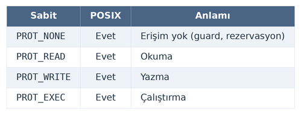

``PROT_READ`` sayfaların *read only* olduğunu belirtir. Anımsanacağı gibi böyle sayfalara yazma yapılırsa, işlemci
exception oluşturur ve proses ``SIGSEGV`` sinyali ile sonlandırılır. ``PROT_WRITE``, sayfalara yazma yapılabileceğini
belirtmektedir. Örneğin ``PROT_READ|PROT_WRITE`` hem okuma hem de yazma anlamına gelmektedir. ``PROT_EXEC`` ilgili
sayfada bir kod varsa (örneğin oraya bir fonksiyon yerleştirilmişse) o kodun çalıştırılabilirliği üzerinde etkili
olmaktadır. Örneğin Intel ve ARM işlemcilerinde, fiziksel sayfa ``PROT_EXEC`` ile özelliklendirilmemişse o sayfadaki
kodlar çalıştırılamamaktadır. ``PROT_NONE`` o sayfaya herhangi bir erişimin mümkün olamayacağını belirtmektedir. Yani
``PROT_NONE`` olan bir sayfa ne okunabilir ne de yazılabilir. Bu tür sayfa özellikleri *guard page* oluşturmak için
kullanılabilmektedir. Bir sayfanın koruma özelliği daha sonra da değiştirilebilmektedir. Aslında bütün işlemciler
buradaki koruma özelliklerinin hepsini desteklemeyebilir. Örneğin Intel işlemcilerinde ``PROT_WRITE`` zaten okuma
özelliğini de kapsamaktadır. Bazı işlemciler sayfalarda ``PROT_EXEC`` özelliğini hiç bulundurmamaktadır. Ancak ne olursa
olsun programcı sanki bu özelliklerin hepsi kodun çalıştırıldığı işlemcide varmış gibi bu parametreyi oluşturmalıdır.
Böylece kodun başka bir işlemcinin bulunduğu sistemde de düzgün çalışması sağlanacaktır.

Fonksiyonun dördüncü parametresi (``flags`` parametresi) çeşitli bayrakların bileşimleriyle oluşturulmaktadır. Bu
bayrakların listesini aşağıda bir tablo hâlinde veriyoruz. Linux POSIX'te belirtilen bayraklardan daha fazlasını
desteklemektedir. Tablonun üçüncü sütununda ilgili bayrağın POSIX tarafından desteklenip desteklenmediği
belirtilmektedir:

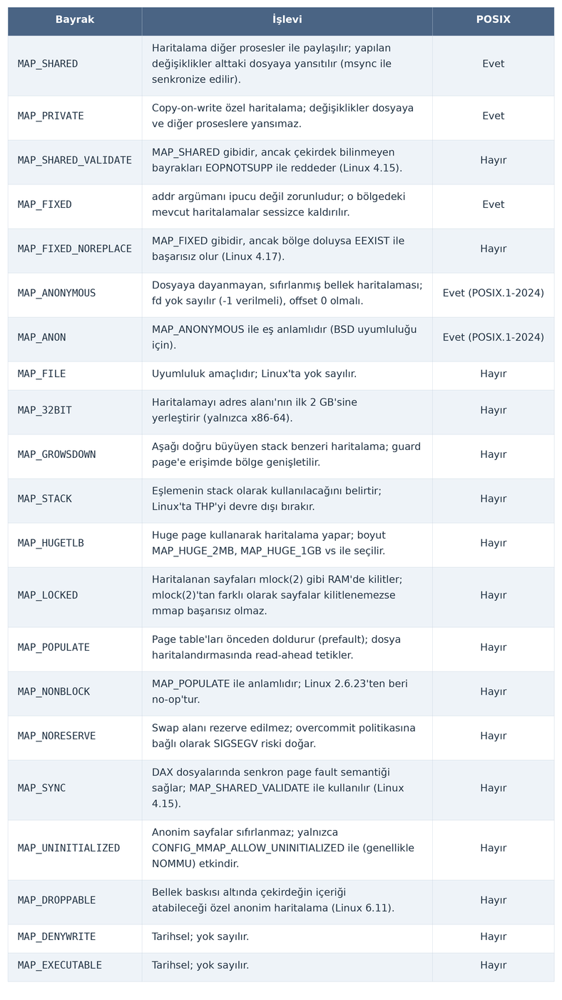

Aşağıdaki iki bayraktan yalnızca biri kullanılabilir, bu bayraklar birlikte kullanılmaz:

.. code-block:: c

    MAP_PRIVATE
    MAP_SHARED

``MAP_PRIVATE`` ile oluşturulan haritalamaya *özel haritalama (private mapping)*, ``MAP_SHARED`` ile oluşturulan
haritalamaya ise *paylaşımlı haritalama (shared mapping)* denilmektedir. ``MAP_PRIVATE`` *copy-on-write* denilen
semantik için kullanılmaktadır. *Copy-on-write* işlemi *yazma yapılana kadar sanal sayfaların aynı fiziksel sayfalara yönl
endirilmesi ancak yazmayla birlikte o sayfaların kopyalarının çıkartılıp yazmaların o prosese özel olarak yapılması*
anlamına gelmektedir. ``MAP_PRIVATE`` bayrağı birden fazla proses tarafından paylaşılan *VMA*'ların söz konusu olduğu
durumda yazma yapıldığında bunların ayrıştırılması amacıyla kullanılmaktadır. Başka bir deyişle ``MAP_PRIVATE`` bayrağı
şunlara yol açmaktadır:

- *VMA*'dan okuma yapıldığında paylaşılan bellek alanından okuma yapılır.
- *VMA*'ya yazma yapıldığında bu yazma paylaşılan bellek alanına yansıtılmaz. O anda yazılan sayfanın bir kopyası
  çıkartılarak yazma o kopya üzerine yapılır. Dolayısıyla başka bir proses bu yazma işlemini göremez.

``MAP_PRIVATE`` ile tahsis edilen alan dosya tabanlı ise ya da paylaşılan bir bellek alanı ise, diğer bir proses o alana
yazma yaptığında onun yazdığını ``MAP_PRIVATE`` yapan prosesin görüp görmeyeceği POSIX standartlarında
*belirsiz (unspecified)* bırakılmıştır. Linux sistemlerinin man sayfasında da bu durum *belirsiz (unspecified)* olarak
belirtilmiş olsa da mevcut Linux çekirdeklerinde başka bir proses özel haritalanmış bir *VMA*'ya yazma yaptığında bu
yazma özel haritalanmış proseste görülmektedir. Ancak özel haritalama yapan proses sayfaya yazma yaptığında artık o
sayfanın kopyası çıkartılacağı için bu yazma işleminden sonraki diğer prosesin yaptığı yazma işlemleri görülmemektedir.

``MAP_SHARED`` bayrağı ise paylaşılan bellek alanı söz konusu olduğunda yazma işleminin paylaşılan bellek alanına
yapılacağını yani *copy-on-write* yapılmayacağını belirtmektedir. Dolayısıyla ``MAP_SHARED`` bir haritalamada paylaşılan
alana yazılanlar diğer prosesler tarafından görülür. Normal olarak programcılar proseslerarası haberleşme için
paylaşımlı haritalama kullanırlar. Özel haritalama (yani *copy-on-write*) bazı özel durumlarda tercih edilmektedir.
Örneğin çekirdek (``exec`` fonksiyonları) çalıştırılabilir dosyanın ``.data`` bölümünü özel haritalama yaparak belleğe
yüklemektedir.

Yukarıda da belirttiğimiz gibi fonksiyonun ``flags`` parametresinde ``MAP_PRIVATE`` ve ``MAP_SHARED`` değerlerinin
yalnızca biri kullanılabilir. Ancak bu değerlerden biri ile ``MAP_FIXED`` değeri bit düzeyinde OR işlemine de
sokulabilmektedir. ``MAP_FIXED`` bayrağı fonksiyonun birinci parametresindeki adres ``NULL`` geçilmemişse bu adresin
kendisinin aynen (hiç değiştirilmeden) kullanılması gerektiğini belirtmektedir. Yani bu adresin yakınındaki herhangi bir
yer değil tam olarak bu adresten itibaren tahsisat yapılmaya çalışılacak ve fonksiyon bu adresin aynısıyla geri
dönecektir. (Tabii bu durumda programcının verdiği adres uygun olmayabilir. Bu durumda fonksiyon da başarısız olur.)
Eğer ``MAP_FIXED`` bayrağı belirtilmişse Linux sistemlerinde birinci parametredeki adresin sayfa katlarında olma
zorunluluğu vardır. Ancak POSIX standartları *may require* ifadesiyle işletim sisteminin bunu zorunlu tutmayabileceğini
belirtmektedir. ``MAP_FIXED`` ile belirtilen adreste daha önce bir haritalama yapıldıysa ``MAP_FIXED`` bayrağı o
haritalamayı sessizce kaldırıp (``munmap`` mekanizmasıyla) tahsisatı yine yapmaktadır. Bu nedenle ``MAP_FIXED``
kullanırken dikkat etmek gerekir.

``MAP_ANONYMOUS`` bayrağı *anonim haritalama (anonymous mapping)* yapmak için kullanılmaktadır. Anonim haritalama dosya
tabanlı olmayan (yani bellek tabanlı dosya biçiminde olmayan) *VMA* tahsisatları için kullanılmaktadır. Dolayısıyla
anonim haritalama yapılırken ``mmap`` fonksiyonunun ``fd`` ve ``offset`` parametreleri dikkate alınmamaktadır. Ancak
POSIX standartlarında ``MAP_ANONYMOUS`` bayrağı kullanıldığında ``fd`` parametresinin ``-1``, ``offset`` parametresinin
ise ``0`` olarak girilmesi gerektiği belirtilmektedir. Bu durum sağlanmazsa fonksiyon başarısız olmaktadır.

``mmap`` fonksiyonunun son iki parametresi (yani ``fd`` ve ``offset`` parametreleri) oluşturulan *VMA* için kullanılacak
dosyayı (backing store) belirtmektedir. Bir *VMA* bir dosyanın belli bir kısmını tutuyor olabilir. Bu duruma işletim
sistemleri dünyasında *bellek tabanlı dosyalar (memory-mapped file)* denilmektedir. Biz bu son iki parametreye bir
dosya betimleyicisi ve offset girersek artık sanki dosyanın o parçası bellekte o *VMA* içerisine çekilmiş gibi bir 
etki oluşmaktadır.``mmap`` fonksiyonu başarı durumunda tahsis edilen *VMA*'nın sanal bellek adresiyle, başarısızlık durumunda
``MAP_FAILED`` (genellikle ``(void *)-1`` biçiminde define edilmektedir) özel değeriyle geri dönmektedir.

Şimdi kullanıcı modunda anonim haritalama ile *VMA* oluşturma örneğini verelim. Burada ``mmap`` fonksiyonunda ``flags``
parametresine ``MAP_PRIVATE|MAP_ANONYMOUS`` geçeceğiz. ``fd`` parametresi ve ``offset`` parametresi ``MAP_ANONYMOUS``
nedeniyle artık fonksiyon tarafından kullanılmayacaktır, onlara da sırasıyla ``-1`` ve ``0`` değerlerini geçeceğiz:

.. code-block:: c

    char *vma;

    if ((vma = (char *)mmap(NULL, 8192, PROT_READ|PROT_WRITE, MAP_PRIVATE|MAP_ANONYMOUS, -1, 0)) == MAP_FAILED)
        exit_sys("mmap");

    strcpy(vma, "this is a test");
    puts(vma);

Burada biz prosesin sanal bellek alanında 8192 byte uzunluğunda (tipik olarak 2 sayfa) bir *VMA* oluşturduk. Bu
*VMA*'daki sayfaların ``PROT_READ|PROT_WRITE`` özelliğine sahip olduğuna dikkat ediniz. Bu sayfalardan hem okuma
yapılabilecek hem de yazma yapılabilecektir. Tabii aslında izleyen paragraflarda da göreceğimiz gibi tahsis edilen *VMA*, dosyanın sayfa önbelleği 
ile ilişkilendirilmektedir.

``mmap`` fonksiyonu başarı durumunda tahsis edilen *VMA*'nın sanal bellek adresiyle, başarısızlık durumunda
``MAP_FAILED`` (genellikle ``(void *)-1`` biçiminde define edilmektedir) özel değeriyle geri dönmektedir.

Şimdi kullanıcı modunda anonim haritalama ile *VMA* oluşturma örneğini verelim. Burada ``mmap`` fonksiyonunda ``flags``
parametresine ``MAP_PRIVATE|MAP_ANONYMOUS`` geçeceğiz. ``fd`` parametresi ve ``offset`` parametresi ``MAP_ANONYMOUS``
nedeniyle artık fonksiyon tarafından kullanılmayacaktır, onlara da sırasıyla ``-1`` ve ``0`` değerlerini geçeceğiz:

.. code-block:: c

    char *vma;

    if ((vma = (char *)mmap(NULL, 8192, PROT_READ|PROT_WRITE, MAP_PRIVATE|MAP_ANONYMOUS, -1, 0)) == MAP_FAILED)
        exit_sys("mmap");

    strcpy(vma, "this is a test");
    puts(vma);

Burada biz prosesin sanal bellek alanında 8192 byte uzunluğunda (tipik olarak 2 sayfa) bir *VMA* oluşturduk. Bu
*VMA*'daki sayfaların ``PROT_READ|PROT_WRITE`` özelliğine sahip olduğuna dikkat ediniz. Bu sayfalardan hem okuma
yapılabilecek hem de yazma yapılabilecektir.

Normal olarak bir *VMA* ``mmap`` fonksiyonuyla tahsis edildiğinde henüz o alan için fiziksel bellek tahsis
edilmemektedir ve bazı istisna durumlar dışında prosesin sayfa tablosunda ilgili sayfalar için bir ayarlama
yapılmamaktadır. Zaten sayfa tablosu kurulduğunda tüm kademe tablolarının girişlerinin hepsinin P biti ``0``'dır.
Fiziksel bellekteki tahsisat *VMA* alanına erişildiğinde oluşan *sayfa hatası (page fault)* yoluyla yapılmaktadır. İşte
Linux'a özgü ``MAP_POPULATE`` bayrağı girilirse bu durumda fiziksel bellek tahsisatı işin başında yapılıp sayfa tablosu
girişleri de tahsisat sırasında oluşturulmaya çalışılır. Eğer haritalama dosya tabanlı yapılıyorsa ``MAP_POPULATE``
ilgili dosyaya ilişkin parçaların sayfa önbelleğine çekilmesi anlamına da gelmektedir. Fakat ``MAP_POPULATE`` tek başına
*VMA* sayfalarının fiziksel belleğe çekilmesini garanti de etmemektedir. Bu bayrak *VMA* sayfalarına erişme işlemini
simüle etmektedir. Bu erişme ilgili sayfanın fiziksel belleğe çekilmesini sağlıyorsa sayfa fiziksel belleğe çekilir,
sağlamıyorsa çekilmez. Çekirdek bayraklara bakarak *VMA* sayfaları için *okuma veya yazma işlemlerini* simüle
eder. Aşağıda ``MAP_POPULATE`` bayrağı girildiğinde diğer bayrakların durumuna göre sayfa tablosu girişlerinde ne
olacağının bir özeti verilmiştir.

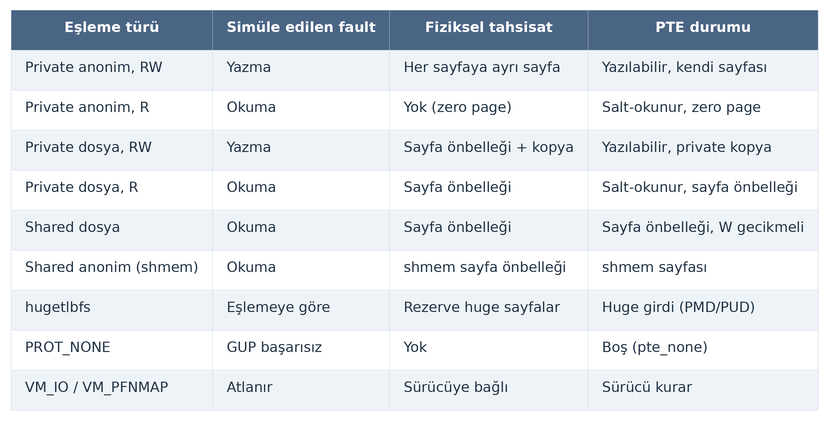

Copy-on-write özelliği ile (yani ``MAP_PRIVATE`` ile) haritalama ile tahsis edilen bellek alanına yazma yapıldığında
yazılanlar sayfa flush edileceği zaman ya da bellekten atılacağı zaman takas dosyalarına aktarılmaktadır. Normal copy-
on-write tahsisatlarında işin başında takas dosyalarında yeterli boş yerin olup olmadığı da sorgulanmaktadır. Buna
İngilizce *commit* işlemi denilmektedir. İşte ``MAP_NORESERVE`` bayrağı bu *commit* işleminin yapılmamasına yol
açmaktadır. Tabii takas dosyalarında baştan bir *commit* yapılmadığı için doğrudan geri alım (direct reclaim) işlemi
sırasında uç bir durum olarak *OOM Killer* mekanizması devreye sokularak yer açmak isteyen proses
sonlandırılabilmektedir. Flusher thread'lerin yalnızca dosya sayfalarını flush ettiğini anımsayınız. ``MAP_PRIVATE``
haritalamada hiçbir durumda (dosya tabanlı olsa bile) sayfalar flusher thread'lerin ilgi alanında değildir. Aşağıda
haritalama türü ile flusher thread'lerin ilişkisini bir tablo hâlinde veriyoruz:

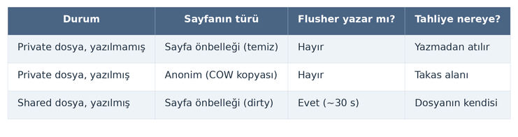

``MAP_HUGE_2MB`` ve ``MAP_HUGE_1GB`` bayrakları standart sayfa boylarında değil (yani tipik 4K) 2 MB'lik ve 1 GB'lik
sayfaların tahsis edilmesini sağlamaktadır.

``MAP_LOCKED`` bayrağı tahsis edilen *VMA*'daki sayfaların fiziksel bellekten sayfa geri alımı sırasında atılmamasını
sağlamaktadır.

``MAP_GROWSDOWN`` bayrağı bir çeşit stack etkisi yaratmaktadır. Bu bayrakla tahsisat yapıldığında bellekte stack gibi bu
alanın yukarısına (yani düşük adrese) erişildiğinde otomatik olarak *VMA* büyütülmektedir. ``MAP_STACK`` bayrağı artık
işlevselliğini kaybetmiştir, geçmişe doğru uyum için bulundurulmaktadır.

``MAP_SYNC`` bayrağı haritalama dosya tabanlı yapılıyorsa dosyanın metadata verilerinin yazma ve okuma sırasında disk
ile güncel hâle getirilmesini sağlamaktadır.

``MAP_32BIT`` bayrağı 64 bit sistemlerdeki 32 bit programlar için tahsisatın ilk 2 GB içerisinde yapılmasını
sağlamaktadır.

``MAP_UNINITIALIZED``: Yalnızca gömülü, MMU'suz sistemlerde (sayfa tablosu ve sayfa koruması olmayan sistemlerde) ve
``CONFIG_MMAP_ALLOW_UNINITIALIZED`` konfigürasyon parametresi aktif olacak biçimde derleme yapılmışsa anonim sayfaların
sıfırlanmamasına izin verir; normal Linux çekirdeklerinde bu bayrak dikkate alınmamaktadır.

munmap Fonksiyonu
=================

``mmap`` POSIX fonksiyonuyla tahsis edilen *VMA* ``munmap`` fonksiyonuyla serbest bırakılabilir. ``munmap``
fonksiyonunun prototipi şöyledir:

.. code-block:: c

    #include <sys/mman.h>

    int munmap(void *addr, size_t len);

Fonksiyonun birinci parametresi, daha önce tahsis edilen *VMA*'da bulunan kısmın adresini almaktadır, ikinci parametresi
ise unmap edilecek alanın uzunluğunu belirtmektedir. Fonksiyon birinci parametresiyle belirtilen adresten itibaren
ikinci parametresinde belirtilen miktardaki byte'ı içeren kısmı serbest bırakmaktadır. POSIX standartları işletim
sistemlerinin birinci parametrede belirtilen adresin sayfa katlarında olmasını zorlayabileceğini (may require)
belirtmektedir. Linux'ta birinci parametrede belirtilen adres sayfa katlarında olmak zorundadır. Ancak uzunluğun sayfa
katlarında olma zorunluluğu yoktur. Uzunluk sayfa katlarında değilse sayfa katlarına yukarıya doğru yuvarlanmaktadır.
Fonksiyon başarı durumunda 0 değerine, başarısızlık durumunda -1 değerine geri döner ve ``errno`` değişkeni
uygun biçimde set edilir. ``munmap`` ile zaten tahsis edilmemiş olan bir alan serbest bırakılmaya çalışılırsa fonksiyon
bir şey yapmaz. Bu durumda fonksiyon başarısızlıkla geri dönmemektedir.

``munmap`` fonksiyonu Linux sistemlerinde ``sys_munmap`` isimli sistem fonksiyonunu çağırmaktadır.

``munmap`` ile serbest bırakma işlemi tahsis edilen *VMA*'nın bir kısmı için de yapılabilmektedir. Bu durumda çekirdek
*VMA*'yı ardışıl olmayan parçalara kendisi bölmektedir. Örneğin:

Burada *m* sanal bellekteki *VMA*'yı, *x* ise diğer alanları göstermektedir. Şimdi biz bu *VMA*'nın arasında iki
sayfalık bir bölgeyi serbest bırakalım. Çekirdek bu durumda *VMA*'yı o alan boş olacak biçimde iki parçaya bölmektedir:

Görüldüğü gibi artık sanki iki ayrı *VMA* varmış gibi işlem uygulanmaktadır.

Proses bittiğinde tüm *VMA*'lar zaten işletim sistemi tarafından serbest bırakılmaktadır.

Örneğin:

.. code-block:: c

    char *vma;

    if ((vma = (char *)mmap(NULL, 8192, PROT_READ|PROT_WRITE, MAP_PRIVATE|MAP_ANONYMOUS, -1, 0)) == MAP_FAILED)
        exit_sys("mmap");

    strcpy(vma, "this is a test");
    puts(vma);

    if (munmap(vma, 8192) == -1)
        exit_sys("munmap");

Aşağıda örneği bütünsel olarak veriyoruz:

.. code-block:: c

    #include <stdio.h>
    #include <stdlib.h>
    #include <string.h>
    #include <sys/mman.h>

    void exit_sys(const char *msg);

    int main(void)
    {
        char *vma;

        if ((vma = (char *)mmap(NULL, 8192, PROT_READ|PROT_WRITE, MAP_PRIVATE|MAP_ANONYMOUS, -1, 0)) == MAP_FAILED)
            exit_sys("mmap");

        strcpy(vma, "this is a test");
        puts(vma);

        if (munmap(vma, 8192) == -1)
            exit_sys("munmap");

        return 0;
    }

    void exit_sys(const char *msg)
    {
        perror(msg);
        exit(EXIT_FAILURE);
    }

mprotect Fonksiyonu
===================

``mmap`` ile oluşturulan *VMA*'nın koruma bayrakları daha sonra ``mprotect`` isimli POSIX fonksiyonuyla
değiştirilebilmektedir. ``mprotect`` fonksiyonunun parametrik yapısı şöyledir:

.. code-block:: c

    #include <sys/mman.h>

    int mprotect(void *addr, size_t len, int prot);

Fonksiyonun birinci parametresi koruma özelliği değiştirilecek alanın başlangıç adresini belirtmektedir. POSIX
standartlarında bu adresin sayfa katlarında olması zorunlu tutulmamıştır. Ancak işletim sisteminin bunu zorunlu
tutabileceği (may require) belirtilmiştir. İkinci parametre uzunluğu belirtmektedir. Verilen adres ve uzunluğu etkileyen
*VMA*'nın koruma özellikleri değiştirilmektedir. Bu değiştirme Linux sistemlerinde önceki *VMA*'nın parçalanması
sonucunu da doğurabilmektedir. Son parametre değiştirilecek yeni koruma bayraklarını belirtmektedir.

Ayrıca POSIX standartlarında da bulunan *VMA*'nın fiziksel bellekte kalıcılığını sağlayan (yani takas dosyasına
aktarılmasını engelleyen) ``mlock`` fonksiyonu da bulunmaktadır. Biz bu fonksiyondan daha önce de bahsetmiştik:

.. code-block:: c

    #include <sys/mman.h>

    int mlock(const void *addr, size_t len);

Lock edilen kısım ``munlock`` fonksiyonuyla eski hâline getirilebilir:

.. code-block:: c

    #include <sys/mman.h>

    int munlock(const void *addr, size_t len);

VMA'ların Dosylarla İlişkilendirilmesi
======================================

Şimdi de ``mmap`` fonksiyonu ile tahsis ettiğimiz *VMA*'yı bir dosya ile ilişkilendirelim. Yukarıda da belirttiğimiz
gibi bu işleme işletim sistemleri terminolojisinde *bellek tabanlı dosyalar (memory-mapped file)* denilmektedir. Bir
dosyanın belli bir kısmını bellek tabanlı hâle getirdikten sonra artık o bellek alanından okuma yaptığımızda dosyadan okuma yapmış
oluruz, o bellek alanına yazma yaptığımızda dosyaya yazmış oluruz. Bellek tabanlı dosya oluşturmak için ``mmap``
fonksiyonunun son iki parametresine sırasıyla ilgili dosyanın betimleyicisinin ve haritalamanın dosyanın hangi
offset'inden itibaren yapılacağına ilişkin offset değerinin geçirilmesi gerekir. Tabii dosyanın ``mmap`` fonksiyonuna
girilen ``prot`` parametresine uygun olacak biçimde açılmış olması gerekir. Örneğin:

.. code-block:: c

    char *vma;
    int fd;
    struct stat finfo;

    if ((fd = open("test.txt", O_RDWR)) == -1)
        exit_sys("open");

    if (fstat(fd, &finfo) == -1)
        exit_sys("fstat");

    if ((vma = (char *)mmap(NULL, finfo.st_size, PROT_READ|PROT_WRITE, MAP_SHARED, fd, 0)) == MAP_FAILED)
        exit_sys("mmap");

    printf("%.10s", vma);
    memcpy(vma, "xxxxx", 5);

    if (msync(vma, finfo.st_size, MS_SYNC) == -1)   /* POSIX'te gerekli Linux'ta gerek yok */
        exit_sys("msync");

    if (munmap(vma, finfo.st_size) == -1)
        exit_sys("munmap");

    close(fd);

Burada ``test.txt`` dosyası ``O_RDWR`` bayrağıyla read/write biçimde açılmıştır. ``mmap`` fonksiyonuna bu betimleyici
geçirilmiştir. Bu örnekte dosyanın tamamının haritalanması için önce dosya uzunluğu ``fstat`` fonksiyonuyla elde
edilmiştir. Artık ilgili bellek alanına yazma yapıldığında dosyaya yazma yapılmış gibi işlem uygulanacaktır. Bunun
çekirdek tarafında nasıl sağlandığını izleyen paragraflarda ele alacağız.

Aşağıda bellek tabanlı dosya örneğini bütünsel olarak veriyoruz:

.. code-block:: c

    #include <stdio.h>
    #include <stdlib.h>
    #include <string.h>
    #include <fcntl.h>
    #include <sys/stat.h>
    #include <unistd.h>
    #include <sys/mman.h>

    void exit_sys(const char *msg);

    int main(void)
    {
        char *vma;
        int fd;
        struct stat finfo;

        if ((fd = open("test.txt", O_RDWR)) == -1)
            exit_sys("open");

        if (fstat(fd, &finfo) == -1)
            exit_sys("fstat");

        if ((vma = (char *)mmap(NULL, finfo.st_size, PROT_READ|PROT_WRITE, MAP_SHARED, fd, 0)) == MAP_FAILED)
            exit_sys("mmap");

        printf("%.10s", vma);
        memcpy(vma, "xxxxx", 5);

        if (msync(vma, finfo.st_size, MS_SYNC) == -1)   /* POSIX'te gerekli Linux'ta gerek yok */
            exit_sys("msync");

        if (munmap(vma, finfo.st_size) == -1)
            exit_sys("munmap");

        close(fd);

        return 0;
    }

    void exit_sys(const char *msg)
    {
        perror(msg);
        exit(EXIT_FAILURE);
    }

Linux çekirdeği pek çok UNIX türevi sistemin çekirdeğinde olduğu gibi bellek tabanlı dosya işlemlerinde arka planda
aslında tahsis edilen *VMA*'nın sanal sayfa numaralarını sayfa tablosunda dosyaya ilişkin sayfa önbelleğindeki fiziksel
sayfalarla eşlemektedir. Yani Linux'ta biz bellek tabanlı dosyayı ``mmap`` ile oluşturduktan sonra o alana yazma
yaptığımızda aslında dosyanın sayfa önbelleğine yazma yapmış oluruz. Sayfa önbellekleri de anımsayacağınız gibi arka
planda periyodik biçimde flush edilmektedir. Bu tasarıma işletim sistemlerinde İngilizce *unified buffer cache*
ya da *unified page cache* de denilmektedir. 

msync Fonksiyonu
----------------

Her ne kadar Linux gibi modern işletim sistemleri yukarıda belirttiğimiz gibi bir işlevselliğe sahipse de POSIX
standartlarında tahsis edilen sanal bellek alanının çekirdek tarafından doğrudan sayfa önbelleğiyle ilişkilendirileceği
yönünde bir garanti verilmemiştir. Bu nedenle POSIX standartlarında bellek tabanlı dosya açılıp o bellek alanına yazma
yapıldıktan sonra yazılanların dosyaya aktarılması için ve dosyaya betimleyici yoluyla yazılanların haritalanan bellek
alanına aktarılabilmesi için ``msync`` fonksiyonunun çağrılması gerektiği belirtilmiştir. Tabii yukarıda da
belirttiğimiz gibi Linux sistemlerinde bu fonksiyonun kullanılmasına çoğu zaman gerek yoktur. Ancak ``msync`` fonksiyonu
aynı zamanda bir flush işleminin yapılmasına da yol açmaktadır. Sayfa önbelleğinin flusher thread'lerle tazelendiğini
anımsayınız. ``msync`` çağrıldığı zaman *VMA*'ya ilişkin dosya sayfaları diske flush edilmektedir.

``msync`` fonksiyonunun prototipi şöyledir:

.. code-block:: c

    #include <sys/mman.h>

    int msync(void *addr, size_t len, int flags);

Fonksiyonun birinci parametresi senkronize edilecek bellek tabanlı dosyaya ilişkin bellek adresini, ikinci parametresi
bunun uzunluğunu belirtmektedir. POSIX standartlarına göre birinci parametrede belirtilen adresin
*sayfa katlarında olması zorunlu değildir, ancak işletim sistemi bunu zorunlu yapabilir (may require)*. Linux
sistemlerinde bu adresin sayfa katlarında olması zorunlu tutulmuştur. Fonksiyonun ikinci parametresi senkronize edilecek
byte miktarını belirtmektedir. POSIX standartlarına göre senkronizasyon işlemine burada belirtilen byte miktarı ve
girilen adresi kapsayan tüm sayfalar sokulmaktadır. (Örneğin birinci parametrede belirtilen adres sayfa katlarında
olsun. Biz ikinci parametre için 7000 değerini girersek sayfa uzunluğu 4K ise sanki 8192 girmiş gibi etki oluşacaktır.)
Fonksiyonun son parametresi flush işleminin yönünü belirtmektedir. Bu parametre aşağıdaki bayraklardan yalnızca birini
alabilir:

``MS_SYNC``: Burada senkronizasyon yönü bellekten diske doğrudur. Yani biz bellek tabanlı dosyanın bellek alanında
değişiklik yaptığımızda bunun diskteki dosyaya yansıtılabilmesi için ``MS_SYNC`` kullanabiliriz. Bu bayrak aynı zamanda
``msync`` fonksiyonu geri döndüğünde flush işleminin bitmiş olmasını garanti etmektedir.

``MS_ASYNC``: ``MS_SYNC`` bayrağı gibidir. Ancak bu bayrakta flush işlemi başlatılıp ``msync`` fonksiyonu hemen geri
döner. Yani bu bayrakta ``msync`` geri döndüğünde flush işlemi başlatılmıştır ancak bitmiş olmak zorunda değildir.

``MS_INVALIDATE``: Bu bayrak dosyanın bellekteki kısmını geçersiz hale getirmektedir. Böylece ilgili bellek alanına 
erişildiğinde dosyanın ilgili kısmı yine belleğe çekilir. Dolaylı olarak bu bayrak diskten belleğe senkronizasyon 
işlevini yerine getirmektedir. 

``munmap`` işlemi ile bellek tabanlı dosyanın bellek alanı serbest bırakılırken ``msync`` işlemi yapılmamaktadır. Ancak
Linux gibi *unified page cache* tasarımına sahip olan sistemlerde bu durum bir soruna yol açmamaktadır.

Fonksiyon başarı durumunda ``0`` değerine, başarısızlık durumunda ``-1`` değerine geri dönmektedir.

Bu durumda biz POSIX standartlarına uygunluk bakımından örneğin bir bellek tabanlı dosyanın bellek alanına bir şeyler
yazdığımızda o alanın flush edilmesi için ``MS_SYNC`` ya da ``MS_ASYNC`` bayraklarıyla ``msync`` çağrısını yapmamız
gerekir:

.. code-block:: c

    if ((maddr = (char *)mmap(NULL, finfo.st_size, PROT_READ|PROT_WRITE, MAP_SHARED, fd, 0)) == MAP_FAILED)
        exit_sys("mmap");

    memcpy(maddr, "ankara", 6);

    if (msync(maddr, finfo.st_size, MS_SYNC) == -1)        /* bellekteki değişiklikler diske yansıtılıyor */
        exit_sys("msync");

Yine POSIX standartlarına uygunluk bakımından dışarıdan bir prosesin bellek tabanlı dosyada değişiklik yapması durumunda
onun bellek tabanlı dosyanın bellek alanına yansıtılabilmesi için ``MS_INVALIDATE`` bayrağı ile ``msync`` fonksiyonunun
çağrılması gerekmektedir. Örneğin:

.. code-block:: c

    if ((maddr = (char *)mmap(NULL, finfo.st_size, PROT_READ|PROT_WRITE, MAP_SHARED, fd, 0)) == MAP_FAILED)
        exit_sys("mmap");

    /* başka bir proses dosya üzerinde değişiklik yapmış olsun */

    if (msync(maddr, finfo.st_size, MS_INVALIDATE) == -1)        /* diskteki değişiklikler belleğe yansıtılıyor */
        exit_sys("msync");

``msync`` fonksiyonunda yalnızca tek bir bayrak kullanılabilmektedir. Bu nedenle iki işlemi ``MS_SYNC|MS_INVALIDATE``
biçiminde birlikte yapmaya çalışmayınız.

