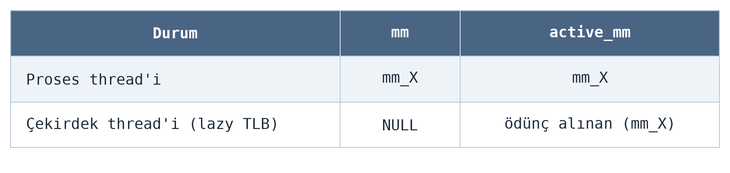
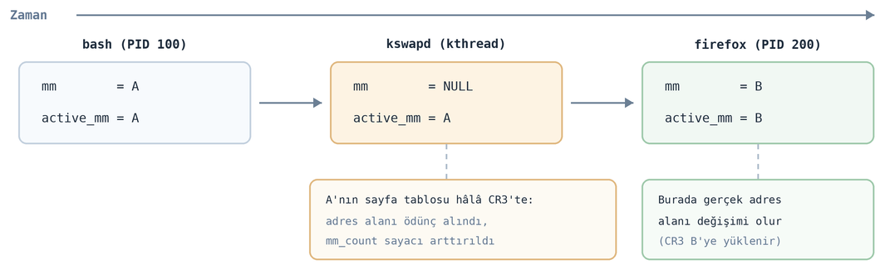

=====================================
**Proseslerin Sanal Bellek Alanları**
=====================================

Bu bölümde proseslerin sanal bellek alanlarının nasıl oluşturulduğu ve nasıl yönetildiği üzerinde duracağız.
Anımsanacağı gibi UNIX/Linux sistemlerinde yeni bir proses ``fork`` isimli POSIX fonksiyonuyla yeni bir thread de
``pthread_create`` isimli POSIX fonksiyonuyla yaratılmaktadır. Bu fonksiyonlar nihayetinde Linux çekirdeğindeki
``sys_fork`` ve/veya ``sys_clone`` fonksiyonlarını çağırmaktadır. ``fork`` fonksiyonunun bir prosesin özdeş kopyasını
oluşturduğunu anımsayınız. ``fork`` fonksiyonu çağrıldığında yeni bir ``task_struct`` (proses kontrol bloğu) nesnesi
yaratılmakta ve kabaca üst prosesin ``task_struct`` nesnesinin içeriği alt prosesin ``task_struct`` nesnesine
kopyalanmaktadır. ``task_struct`` içerisindeki elemanların birçoğunun göstericiler yoluyla asıl nesneleri gösterdiğini
anımsayınız. Dolayısıyla ``fork`` işlemi büyük ölçüde *derin (deep)* kopyalama biçiminde değil *sığ (shallow)* kopyalama
biçiminde yürütülmektedir. Biz proseslerin ve thread'lerin yaratılması sürecini sonraki bölümde ele alacağız. ``exec``
fonksiyonlarının bir prosesin yaşamına başka bir kodla devam etmesini sağladığını anımsayınız. ``exec`` işlemi
uygulandığında prosesin bellek alanı boşaltılıp başka bir program dosyasından hareketle yeni bir bellek alanı
oluşturulmakta ve proses yaşamına başka bir programın koduyla devam etmektedir. Anımsanacağı gibi UNIX/Linux
sistemlerinde "hem mevcut program çalışmaya devam etsin hem de başka bir program da çalışsın" isteniyorsa yalnızca
``fork`` ve yalnızca ``exec`` yetersiz kalmaktadır. Bu işlem tipik olarak önce ``fork`` uygulanıp alt proseste ``exec``
uygulanarak gerçekleştirilmektedir. Örneğin:

.. code-block:: c

    pid_t pid;
    /* ... */

    if ((pid = fork()) == -1)
        exit_sys("fork");

    if (pid == 0 && execl("/bin/ls", "/bin/ls", "-l", (char *)NULL) == -1)
        exit_sys("execl");

    /* ... */

Yeni prosesin ``fork`` içerisinden çalışmaya başladığını, ``fork`` fonksiyonundan alt prosesin ``0`` ile, üst prosesin
alt prosesin çıkış koduyla çıktığını anımsayınız.

Biz bu süreci zaten ayrı bir bölümde ele alacağız. Bu bölümde biz prosesin bellek alanının nasıl kayıt altında
tutulduğunu ele alacağız.

Bellek Betimleyicileri ve Sanal Bellek Alanları
===============================================

Prosesin bellek alanına ilişkin tüm bilgiler ``task_struct`` yapısındaki ``mm`` ve/veya ``active_mm`` elemanlarının
gösterdiği ``mm_struct`` nesnelerinde tutulmaktadır:

.. code-block:: c

    struct task_struct {
        /* ... */
        struct mm_struct *mm;
        struct mm_struct *active_mm;
        /* ... */
    };

``mm_struct`` yapısı üzerinde çekirdeğin çeşitli versiyonlarında iyileştirmeler yapılmıştır. Güncel
çekirdeklerde bu yapı oldukça büyüktür:

.. code-block:: c

    struct mm_struct {
        struct {
            /*
             * Fields which are often written to are placed in a separate
             * cache line.
             */
            struct {
                /**
                 * @mm_count: The number of references to &struct
                 * mm_struct (@mm_users count as 1).
                 *
                 * Use mmgrab()/mmdrop() to modify. When this drops to
                 * 0, the &struct mm_struct is freed.
                 */
                atomic_t mm_count;
            } ____cacheline_aligned_in_smp;

            struct maple_tree mm_mt;

            unsigned long mmap_base; /* base of mmap area */
            unsigned long mmap_legacy_base; /* base of mmap area in bottom-up allocations */
    #ifdef CONFIG_HAVE_ARCH_COMPAT_MMAP_BASES
            /* Base addresses for compatible mmap() */
            unsigned long mmap_compat_base;
            unsigned long mmap_compat_legacy_base;
    #endif
            unsigned long task_size; /* size of task vm space */
            pgd_t *pgd;

    #ifdef CONFIG_MEMBARRIER
            /**
             * @membarrier_state: Flags controlling membarrier behavior.
             *
             * This field is close to @pgd to hopefully fit in the same
             * cache-line, which needs to be touched by switch_mm().
             */
            atomic_t membarrier_state;
    #endif

            /**
             * @mm_users: The number of users including userspace.
             *
             * Use mmget()/mmget_not_zero()/mmput() to modify. When this
             * drops to 0 (i.e. when the task exits and there are no other
             * temporary reference holders), we also release a reference on
             * @mm_count (which may then free the &struct mm_struct if
             * @mm_count also drops to 0).
             */
            atomic_t mm_users;

            /* MM CID related storage */
            struct mm_mm_cid mm_cid;

            /* sched_cache related statistics */
            struct sched_cache_stat sc_stat;
    #ifdef CONFIG_MMU
            atomic_long_t pgtables_bytes; /* size of all page tables */
    #endif
            int map_count; /* number of VMAs */

            spinlock_t page_table_lock; /* Protects page tables and some
                                         * counters
                                         */
            /*
             * Typically the current mmap_lock's offset is 56 bytes from
             * the last cacheline boundary, which is very optimal, as
             * its two hot fields 'count' and 'owner' sit in 2 different
             * cachelines, and when mmap_lock is highly contended, both
             * of the 2 fields will be accessed frequently, current layout
             * will help to reduce cache bouncing.
             *
             * So please be careful with adding new fields before
             * mmap_lock, which can easily push the 2 fields into one
             * cacheline.
             */
            struct rw_semaphore mmap_lock;

            struct list_head mmlist; /* List of maybe swapped mm's. These
                                      * are globally strung together off
                                      * init_mm.mmlist, and are protected
                                      * by mmlist_lock
                                      */
    #ifdef CONFIG_PER_VMA_LOCK
            struct rcuwait vma_writer_wait;
            /*
             * This field has lock-like semantics, meaning it is sometimes
             * accessed with ACQUIRE/RELEASE semantics.
             * Roughly speaking, incrementing the sequence number is
             * equivalent to releasing locks on VMAs; reading the sequence
             * number can be part of taking a read lock on a VMA.
             * Incremented every time mmap_lock is write-locked/unlocked.
             * Initialized to 0, therefore odd values indicate mmap_lock
             * is write-locked and even values that it's released.
             *
             * Can be modified under write mmap_lock using RELEASE
             * semantics.
             * Can be read with no other protection when holding write
             * mmap_lock.
             * Can be read with ACQUIRE semantics if not holding write
             * mmap_lock.
             */
            seqcount_t mm_lock_seq;
    #endif
            struct futex_mm_data futex;

            unsigned long hiwater_rss; /* High-watermark of RSS usage */
            unsigned long hiwater_vm; /* High-water virtual memory usage */

            unsigned long total_vm; /* Total pages mapped */
            unsigned long locked_vm; /* Pages that have PG_mlocked set */
            atomic64_t pinned_vm; /* Refcount permanently increased */
            unsigned long data_vm; /* VM_WRITE & ~VM_SHARED & ~VM_STACK */
            unsigned long exec_vm; /* VM_EXEC & ~VM_WRITE & ~VM_STACK */
            unsigned long stack_vm; /* VM_STACK */
            union {
                /* Temporary while VMA flags are being converted. */
                vm_flags_t def_flags;
                vma_flags_t def_vma_flags;
            };

            /**
             * @write_protect_seq: Locked when any thread is write
             * protecting pages mapped by this mm to enforce a later COW,
             * for instance during page table copying for fork().
             */
            seqcount_t write_protect_seq;

            spinlock_t arg_lock; /* protect the below fields */

            unsigned long start_code, end_code, start_data, end_data;
            unsigned long start_brk, brk, start_stack;
            unsigned long arg_start, arg_end, env_start, env_end;

            unsigned long saved_auxv[AT_VECTOR_SIZE]; /* for /proc/PID/auxv */

    #ifdef CONFIG_ARCH_HAS_ELF_CORE_EFLAGS
            /* the ABI-related flags from the ELF header. Used for core dump */
            unsigned long saved_e_flags;
    #endif

            struct percpu_counter rss_stat[NR_MM_COUNTERS];

            struct linux_binfmt *binfmt;

            /* Architecture-specific MM context */
            mm_context_t context;

            mm_flags_t flags; /* Must use mm_flags_* helpers to access */

    #ifdef CONFIG_AIO
            spinlock_t ioctx_lock;
            struct kioctx_table __rcu *ioctx_table;
    #endif
    #ifdef CONFIG_MEMCG
            /*
             * "owner" points to a task that is regarded as the canonical
             * user/owner of this mm. All of the following must be true in
             * order for it to be changed:
             *
             * current == mm->owner
             * current->mm != mm
             * new_owner->mm == mm
             * new_owner->alloc_lock is held
             */
            struct task_struct __rcu *owner;
    #endif

            /* store ref to file /proc/<pid>/exe symlink points to */
            struct file __rcu *exe_file;
    #ifdef CONFIG_MMU_NOTIFIER
            struct mmu_notifier_subscriptions *notifier_subscriptions;
    #endif
    #if defined(CONFIG_TRANSPARENT_HUGEPAGE) && !defined(CONFIG_SPLIT_PMD_PTLOCKS)
            pgtable_t pmd_huge_pte; /* protected by page_table_lock */
    #endif
    #ifdef CONFIG_NUMA_BALANCING
            /*
             * numa_next_scan is the next time that PTEs will be remapped
             * PROT_NONE to trigger NUMA hinting faults; such faults gather
             * statistics and migrate pages to new nodes if necessary.
             */
            unsigned long numa_next_scan;

            /* Restart point for scanning and remapping PTEs. */
            unsigned long numa_scan_offset;

            /* numa_scan_seq prevents two threads remapping PTEs. */
            int numa_scan_seq;
    #endif
            /*
             * An operation with batched TLB flushing is going on. Anything
             * that can move process memory needs to flush the TLB when
             * moving a PROT_NONE mapped page.
             */
            atomic_t tlb_flush_pending;
    #ifdef CONFIG_ARCH_WANT_BATCHED_UNMAP_TLB_FLUSH
            /* See flush_tlb_batched_pending() */
            atomic_t tlb_flush_batched;
    #endif
            struct uprobes_state uprobes_state;
    #ifdef CONFIG_PREEMPT_RT
            struct rcu_head delayed_drop;
    #endif
    #ifdef CONFIG_HUGETLB_PAGE
            atomic_long_t hugetlb_usage;
    #endif
            struct work_struct async_put_work;

    #ifdef CONFIG_IOMMU_MM_DATA
            struct iommu_mm_data *iommu_mm;
    #endif
    #ifdef CONFIG_KSM
            /*
             * Represent how many pages of this process are involved in KSM
             * merging (not including ksm_zero_pages).
             */
            unsigned long ksm_merging_pages;
            /*
             * Represent how many pages are checked for ksm merging
             * including merged and not merged.
             */
            unsigned long ksm_rmap_items;
            /*
             * Represent how many empty pages are merged with kernel zero
             * pages when enabling KSM use_zero_pages.
             */
            atomic_long_t ksm_zero_pages;
    #endif /* CONFIG_KSM */
    #ifdef CONFIG_LRU_GEN_WALKS_MMU
            struct {
                /* this mm_struct is on lru_gen_mm_list */
                struct list_head list;
                /*
                 * Set when switching to this mm_struct, as a hint of
                 * whether it has been used since the last time per-node
                 * page table walkers cleared the corresponding bits.
                 */
                unsigned long bitmap;
    #ifdef CONFIG_MEMCG
                /* points to the memcg of "owner" above */
                struct mem_cgroup *memcg;
    #endif
            } lru_gen;
    #endif /* CONFIG_LRU_GEN_WALKS_MMU */
    #ifdef CONFIG_MM_ID
            mm_id_t mm_id;
    #endif /* CONFIG_MM_ID */
        } __randomize_layout;

        /*
         * The mm_cpumask needs to be at the end of mm_struct, because it
         * is dynamically sized based on nr_cpu_ids.
         */
        char flexible_array[] __aligned(__alignof__(unsigned long));
    };

``mm_struct`` yapısı prosesin sanal bellek alanına ilişkin tüm bilgileri tutmaktadır. Ancak yukarıda da gördüğünüz gibi
yapı oldukça karmaşıktır.

Prosesin sanal adres alanına ilişkin bilgileri tutan ``mm_struct`` nesnesine *Understanding the Linux Kernel* kitabında
*bellek betimleyicisi (memory descriptor)* da denilmektedir. *Bellek betimleyicisi* terimi çekirdek geliştirme
terminolojisinde kullanılan bir terim değildir. Ancak biz de kştabımızda bu nesneye *bellek betimleyicisi* de diyeceğiz.

Prosesin sanal adres alanı içerisindeki aynı özelliklere sahip sayfalardan oluşan alanlar ``vm_area_struct`` isimli bir
yapıyla temsil edilmektedir. Güncel çekirdeklerde bu yapı şöyle tanımlanmıştır:

.. code-block:: c

    struct vm_area_struct {
        /* The first cache line has the info for VMA tree walking. */

        union {
            struct {
                /* VMA covers [vm_start; vm_end) addresses within mm */
                unsigned long vm_start;
                unsigned long vm_end;
            };
            freeptr_t vm_freeptr; /* Pointer used by SLAB_TYPESAFE_BY_RCU */
        };

        /*
         * The address space we belong to.
         * Unstable RCU readers are allowed to read this.
         */
        struct mm_struct *vm_mm;
        pgprot_t vm_page_prot; /* Access permissions of this VMA. */

        /*
         * Flags, see mm.h.
         * To modify use vm_flags_{init|reset|set|clear|mod} functions.
         * Preferably, use vma_flags_xxx() functions.
         */
        union {
            /* Temporary while VMA flags are being converted. */
            const vm_flags_t vm_flags;
            vma_flags_t flags;
        };

    #ifdef CONFIG_PER_VMA_LOCK
        /*
         * Can only be written (using WRITE_ONCE()) while holding both:
         *  - mmap_lock (in write mode)
         *  - vm_refcnt bit at VM_REFCNT_EXCLUDE_READERS_FLAG is set
         * Can be read reliably while holding one of:
         *  - mmap_lock (in read or write mode)
         *  - vm_refcnt bit at VM_REFCNT_EXCLUDE_READERS_BIT is set or vm_refcnt > 1
         * Can be read unreliably (using READ_ONCE()) for pessimistic bailout
         * while holding nothing (except RCU to keep the VMA struct allocated).
         *
         * This sequence counter is explicitly allowed to overflow; sequence
         * counter reuse can only lead to occasional unnecessary use of the
         * slowpath.
         */
        unsigned int vm_lock_seq;
    #endif
        /*
         * A file's MAP_PRIVATE vma can be in both i_mmap tree and anon_vma
         * list, after a COW of one of the file pages. A MAP_SHARED vma
         * can only be in the i_mmap tree.  An anonymous MAP_PRIVATE, stack
         * or brk vma (with NULL file) can only be in an anon_vma list.
         */
        struct list_head anon_vma_chain; /* Serialized by mmap_lock &
                                          * page_table_lock */
        struct anon_vma *anon_vma; /* Serialized by page_table_lock */

        /* Function pointers to deal with this struct. */
        const struct vm_operations_struct *vm_ops;

        /* Information about our backing store: */
        unsigned long vm_pgoff; /* Offset (within vm_file) in PAGE_SIZE
                                    units */
        struct file *vm_file; /* File we map to (can be NULL). */
        void *vm_private_data; /* was vm_pte (shared mem) */

    #ifdef CONFIG_SWAP
        atomic_long_t swap_readahead_info;
    #endif
    #ifndef CONFIG_MMU
        struct vm_region *vm_region; /* NOMMU mapping region */
    #endif
    #ifdef CONFIG_NUMA
        struct mempolicy *vm_policy; /* NUMA policy for the VMA */
    #endif
    #ifdef CONFIG_NUMA_BALANCING
        struct vma_numab_state *numab_state; /* NUMA Balancing state */
    #endif
    #ifdef CONFIG_PER_VMA_LOCK
        /*
         * Used to keep track of firstly, whether the VMA is attached, secondly,
         * if attached, how many read locks are taken, and thirdly, if the
         * VM_REFCNT_EXCLUDE_READERS_FLAG is set, whether any read locks held
         * are currently in the process of being excluded.
         *
         * This value can be equal to:
         *
         * 0 - Detached. IMPORTANT: when the refcnt is zero, readers cannot
         * increment it.
         *
         * 1 - Attached and either unlocked or write-locked. Write locks are
         * identified via __is_vma_write_locked() which checks for equality of
         * vma->vm_lock_seq and mm->mm_lock_seq.
         *
         * >1, < VM_REFCNT_EXCLUDE_READERS_FLAG - Read-locked or (unlikely)
         * write-locked with other threads having temporarily incremented the
         * reference count prior to determining it is write-locked and
         * decrementing it again.
         *
         * VM_REFCNT_EXCLUDE_READERS_FLAG - Detached, pending
         * __vma_end_exclude_readers() completion which will decrement the
         * reference count to zero. IMPORTANT - at this stage no further readers
         * can increment the reference count. It can only be reduced.
         *
         * VM_REFCNT_EXCLUDE_READERS_FLAG + 1 - A thread is either write-locking
         * an attached VMA and has yet to invoke __vma_end_exclude_readers(),
         * OR a thread is detaching a VMA and is waiting on a single spurious
         * reader in order to decrement the reference count. IMPORTANT - as
         * above, no further readers can increment the reference count.
         *
         * > VM_REFCNT_EXCLUDE_READERS_FLAG + 1 - A thread is either
         * write-locking or detaching a VMA is waiting on readers to
         * exit. IMPORTANT - as above, no further readers can increment the
         * reference count.
         *
         * NOTE: Unstable RCU readers are allowed to read this.
         */
        refcount_t vm_refcnt ____cacheline_aligned_in_smp;
    #ifdef CONFIG_DEBUG_LOCK_ALLOC
        struct lockdep_map vmlock_dep_map;
    #endif
    #endif
        /*
         * For areas with an address space and backing store,
         * linkage into the address_space->i_mmap interval tree.
         *
         */
        struct {
            struct rb_node rb;
            unsigned long rb_subtree_last;
        } shared;
    #ifdef CONFIG_ANON_VMA_NAME
        /*
         * For private and shared anonymous mappings, a pointer to a null
         * terminated string containing the name given to the vma, or NULL if
         * unnamed. Serialized by mmap_lock. Use anon_vma_name to access.
         */
        struct anon_vma_name *anon_name;
    #endif
        struct vm_userfaultfd_ctx vm_userfaultfd_ctx;
    #ifdef __HAVE_PFNMAP_TRACKING
        struct pfnmap_track_ctx *pfnmap_track_ctx;
    #endif
    } __randomize_layout;

Karmaşık bu iki veri yapısını basite indirgersek bunları söyleyebiliriz: Prosesin tüm sanal bellek alanına ilişkin
bilgiler ``task_struct`` nesnesinin ``mm`` ve/veya ``active_mm`` elemanlarının gösterdiği ``mm_struct`` nesnesi
içerisindedir. ``mm_struct`` nesnesi de sanal bellek alanlarını belirten ``vm_area_struct`` nesnelerini tutmaktadır.
Çekirdek terminolojisinde hem ``vm_area_struct`` nesnesine hem de onun belirttiği bellek aralığına *VMA (Virtual Memory
Area)* denilmektedir. Biz kursumuzda iki anlamlılığı ortadan kaldırmak için ``vm_area_struct`` nesnesine *sanal bellek
alanı nesnesi* ya da kısaca *VMA nesnesi*, onun belirttiği bellek aralığına ise *sanal bellek alanı* ya da kısaca *VMA*
diyeceğiz. (``mm_struct`` ile belirtilen sanal bellek alanları için *Understanding the Linux Kernel* kitabında *memory area* 
terimi yerine *memory region* terimi kullanılmıştır. *Memory region* terimi çekirdek geliştirme terminolojisinde kullanılan 
bir terim değildir.)

*VMA*'lar tamamen prosesin sanal bellek alanı ile ilgilidir. *VMA*'lar içerisinde fiziksel belleğe ilişkin hiçbir bilgi
tutulmamaktadır. Fiziksel bellek eşleştirmeleri doğrudan sayfa tablosu yoluyla yapılmaktadır.

``mm_struct`` yapısı içerisinde alanlar eskiden *kırmızı-siyah ağacı (red-black tree)* ile tutuluyordu. Çekirdeğin 6.1
versiyonuyla birlikte *maple ağacı (maple tree)* denilen bütünleşik bir veri yapısı kullanılmaya başlanmıştır. Bu
ağacın kök düğümü ``mm_struct`` içerisindeki ``mm_mt`` elemanında tutulmaktadır:

.. code-block:: c

    struct mm_struct {
        /* ... */
        struct {
            struct maple_tree mm_mt;        /* tek yapı: tüm VMA'lar */
            /* ... */
        };
        /* ... */
    };

Peki neden iki ayrı gösterici bulundurulmuştur? Çekirdek thread'lerine bağlamsal geçiş daha az maliyetli olsun diye
``mm`` elemanının yeniden düzenlenmesi yerine ``active_mm`` elemanı kullanılmaktadır. Proses thread'lerinde bu iki
eleman aslında aynı bellek betimleyicisini göstermektedir.

Yani ``mm`` göstericisi "bu thread'in sahip olduğu adres alanını", ``active_mm`` göstericisi ise "o anda işlemcinin sayfa
tablosunda yüklü olan thread'in adres alanını" belirtmektedir. Yukarıda da belirttiğimiz gibi normal proses
thread'lerinde bu iki gösterici aslında aynı bellek betimleyicisini göstermektedir. Farklılaşma çekirdek thread'lerinde
söz konusu olmaktadır. Örneğin *kswapd* gibi *ksoftirqd* gibi *kworker* gibi çekirdek thread'lerinin kullanıcı alanı
yoktur. Bunların ``mm`` göstericileri ``NULL`` durumdadır. Bunların bellek alanları ``active_mm`` göstericisi tarafından
gösterilmektedir. ``active_mm`` elemanı hiçbir zaman ``NULL`` olmamaktadır. Bu eleman kullanıcı proseslerine ilişkin
thread'lerde zaten ``mm`` elemanı ile aynı nesneyi göstermektedir. Çekirdek thread'lerinde ise geçişin yapıldığı (yani
önceki) thread'e ilişkin ``mm_struct`` nesnesini göstermektedir.

Bir proses thread'inden çekirdek thread'ine geçiş yapıldığında sayfa tablosu çekirdek thread'i için değiştirilmez.
Çünkü zaten çekirdek alanı tüm proses thread'lerinin sayfa tablolarında aynı yerde ve aynı biçimde bulunmaktadır. Yani
geçilen çekirdek thread'i aslında geçişin yapıldığı önceki proses thread'inin sayfa tablosunu ödünç almaktadır. Buna
Linux çekirdek terminolojisinde *Lazy TLB* denilmektedir. İşte ``active_mm`` elemanı böylesi bir durumda ödünç alınan
proses thread'inin bellek alanı bilgilerini göstermektedir. Örneğin *bash* prosesine ilişkin bir thread'ten *kswapd*
thread'ine geçiliyor olsun. Oradan da *firefox* prosesinin thread'ine geçilsin. Bu senaryodaki ``mm`` ve ``active_mm``
elemanları aşağıdaki gibi değişecektir:

Çekirdek thread'leri zaten kullanıcı alanına hiç erişmemektedir, bu nedenle işlemcinin de hangi sayfa tablosunu
gösterdiğinin bir önemi yoktur.

Peki neden ``mm`` ve ``active_mm`` biçiminde iki gösterici vardır? Yalnızca ``mm`` ya da ``active_mm`` olsaydı ne
olurdu? İşte çekirdek içerisinde bazı yerlerde "şu anda çalışan çekirdek thread'i mi, adres alanı aslında geçişin
yapıldığı thread'ten ödünç alınmış bir adres alanı mı" kontrolü yapılmaktadır. Çekirdek bu kontrolü pek çok yerde
``mm == NULL`` ile yapmaktadır. Çekirdek ``mm == NULL`` gördüğü zaman bellek betimleyicisi ödünç alınmış bir çekirdek
thread'inin söz konusu olduğunu anlamakta ve bellek alanına artık ``active_mm`` göstericisiyle erişmektedir. Örneğin
aygıt sürücülerde kullandığımız ``copy_from_user`` fonksiyonunu biz çekirdek thread'lerinde kullanamayız. Çünkü çekirdek
thread'leri belli bir proses bağlamında çalışmamaktadır. İşte bu ``copy_from_user`` gibi bir fonksiyonu biz çekirdek
thread'i içerisinde kullandığımızda bu fonksiyon kendi içerisinde ``if (current->mm == NULL)`` kontrolü yaptığı için
hemen başarısızlıkla geri dönmektedir. Özetle çekirdek kodlarında ``if (current->mm == NULL)`` kontrolü "bu bir çekirdek
thread'i mi" sorusunu yanıtlamaktadır.

Sistemdeki tüm proseslerin sayfa tablolarının yüksek anlamlı kısımlarının aslında hep aynı olduğunu ve bu alanların
çekirdeğe ilişkin olduğunu anımsayınız. Kullanıcı prosesine ilişkin bir thread'ten çekirdek thread'ine geçildiğinde
sayfa tablosunun değiştirilmesine gerek kalmamaktadır. Çekirdek thread'i geçilen proses thread'inin sayfa tablosunu
kullanmaya devam etmektedir.

Çekirdek kodlarında prosesin sanal bellek alanına erişmek için her zaman ``mm`` göstericisi kullanılmaktadır.
``active_mm`` göstericisi çekirdekte yalnızca bazı yerlerde kullanılmaktadır.

